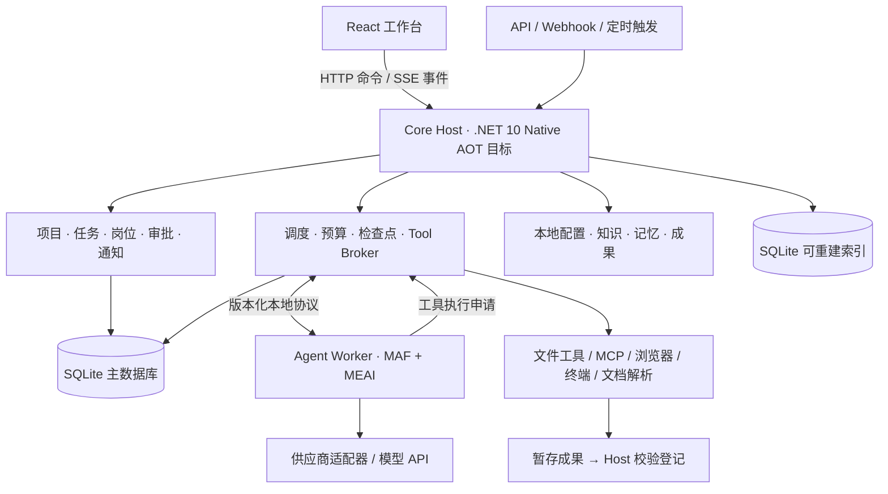

# 系统架构与 AOT 边界

更新：2026-10-15。根据产品研究修订的设计基线，完整模块名与接口名为本项目建议，不是对 MAF 现有 API 的声明。P0 已完成限定范围的复审验证，见 [交付记录](validation/2026-10-14/p0/review-and-delivery.md)；正式工程已建立，当前实际接口和本地闭环范围见 [17 合同](17-production-m1-contract.md)、[18 实测](18-production-m1-delivery.md)，后续阶段见 [14 生产方案](14-production-implementation-plan.md)。

## 1. 推荐结构

采用模块化单体业务核心，加受控的执行进程。不引入消息中间件、分布式服务或独立数据库服务器。

Core Host 与 MAF Worker 分进程；起步使用一个执行槽，需要并发时在同一 Host 下启用有上限的 Worker/执行槽，不按每个岗位启动常驻服务。浏览器、解析器或 MCP 服务按需启动。MAF 是否能进一步进入 AOT 进程，由验证结果决定，不作为第一版可用的前置条件。

前端通信合同见 [HTTP/SSE 与 Runtime 协议](11-frontend-runtime-protocol.md)。NextCoWork 本机使用 Electron IPC、远端设备使用 WSS，详见 [固定源码研究](research/nextcowork-runtime-communication.md)。本项目继续浏览器基线，未来可复用 React 加 [Electron 桌面壳](12-react-and-electron.md)，而不把 AI runtime 绑到窗口进程。

## 2. 框架与自研边界

| 层 | 负责 | 不负责 |
| --- | --- | --- |
| React/TypeScript | 页面、表单、流式展示、成果预览 | 持有 API 密钥、决定任务最终状态、直接写主数据库 |
| Core Host | 本地 API、业务规则、状态、调度、预算、授权、事件与恢复 | 装载任意第三方程序集、通吃所有 SDK |
| MAF 运行适配层 | 以 MAF 驱动模型与工具调用循环、流式事件、可用的会话／workflow 能力 | 将框架 checkpoint 当作整套业务数据库 |
| Microsoft.Extensions.AI | 统一模型和 Embedding 接口；供应商差异在适配器中收敛 | 假设所有模型能力相同 |
| Tool Broker | 验证工具 schema、作用域、授权、参数、超时和调用结果 | 用技能提示词代替实际操作限制 |
| Worker/Runner | SDK、MCP 客户端、网页、命令、复杂文档解析 | 自行领取数据库任务、直接变更业务状态 |
| SQLite + 文件 | 保存各自负责的权威数据，提供恢复依据 | 把查询缓存与主数据混为一谈 |

MAF 用来避免重写模型工具循环；外层 Harness 负责让该循环在真实任务里可靠运行。工作分派、预算、持久状态和对外副作用仍需要产品自己定义。[MAF 专项证据](research/dotnet-maf-aot-evidence.md)。

多 Agent 的业务协作先用任务依赖图、队列和结构化交接实现。MAF Workflow 用于有明确收益的局部流程；不把所有项目、岗位与任务都编码为巨大的框架工作流。

三层主线明确为：产品层管理长期岗位、任务责任和成果验收；Harness 管理 Run/Attempt、等待条件、Operation 与恢复；Worker 提供模型循环和具体协议适配。临时子 Agent 是 child Run 的执行身份，业务责任仍落实到任务负责人；定义见 [04](04-agent-harness-and-projects.md)。

[DeepSeek Harness](research/products/deepseek-harness.md)证明源码层面存在独立 Web Host 和可替换能力组件的实现路径；我们借鉴运行面与客户端分离，不照搬其所有核心行为可替换的插件树。业务状态、审批、Operation 写前屏障和恢复判定仍由 Host 强制管理，普通扩展不能关闭这些保证。

## 3. AOT 决策

Native AOT 不支持任意动态加载托管程序集或运行时生成代码。不同库、运行时标识和实际使用路径仍需发布验证。[.NET Native AOT 官方说明](https://learn.microsoft.com/en-us/dotnet/core/deploying/native-aot/)。

| 组件 | 目标 | 失败时的处理 |
| --- | --- | --- |
| Core Host：Minimal APIs、静态资源、任务／调度／策略 | 必须验证 AOT 发布 | 消除反射依赖或把非核心依赖隔离；验证前不宣称达成 |
| 核心 JSON 与业务 DTO | 显式类型 + System.Text.Json 源生成 | 改为显式转换器，不用忽略警告掩盖问题 |
| 主数据库访问 | 优先 Microsoft.Data.Sqlite + 参数化 SQL | 验证原生 SQLite 打包；不为简单模型引入复杂动态映射 |
| MAF、模型 SDK | 默认普通 .NET Worker | 可在后续验证通过后改为 AOT，无需更改业务契约 |
| 动态 MCP 工具 | JSON Schema + JSON 数据调用 | 不为每个外部 schema 运行时生成 CLR 类型；必要实现留在 Worker |
| 插件 | 声明包 + 进程／远端服务 | 不在 AOT Host 中 `Assembly.Load` 插件 |
| OCR／Office／浏览器 | 按需 Runner | 用现有成熟运行时，独立健康检查与版本固定 |

自定义协议可以在适配层内部使用 HTTP 客户端实现 MEAI 接口；业务层不直接拼供应商请求。动态输入以 `JsonElement` 等数据表示，并使用已验证的 JSON Schema 校验器；不能默认任意校验器都兼容 AOT。

不把“打开 PublishAot 属性”“普通编译通过”或“上游标为 AOT friendly”当成整套系统 AOT 成功。发布门槛是目标平台产物实际运行、工具调用和恢复成功，见 [交付验证](08-delivery-and-validation.md)。

## 4. 业务模块

建议初始逻辑模块：`Workspace`、`Projects`、`Agents`、`Conversations`、`Execution`、`Capabilities`、`Knowledge`、`Memory`、`Notifications`。

逻辑模块不必一对一拆成程序集。建议最初只有 Host、Domain/Application、Infrastructure、AgentWorker、Contracts、Web 和测试项目，随着独立依赖需要再拆分。

核心接口建议：`IAgentRuntime`、`IToolBroker`、`IWorkspaceCatalog`、`IKnowledgeRetriever`、`IMemoryStore`、`IArtifactStore`、`INotificationSender`。接口围绕替换边界建立，不给每个实体制造一套通用仓储。

## 5. Host 与 Worker 契约

第一版使用版本化 JSON-RPC over stdio：输入输出流专用于协议，日志写 stderr；协议包含请求 ID、Run ID、事件序号、协议版本与错误码。后续需要远程 Worker 时再增加鉴权的网络传输。

- Host 下发固定 RunSnapshot：taskRevision、assignmentVersion、执行身份与岗位版本、模型连接引用、ContextManifest、工具集合、总预算、工作目录和配置版本。
- Worker 返回文本增量、工具申请、阶段更新、checkpoint 和终态候选；Host 落库后再向 UI 发布可恢复事件。
- 工具调用必须经过 Broker；Host 先持久接纳逻辑操作 ID 和意图，再授权派发。等待审批或子任务时保存可验证的继续点，释放可安全释放的执行槽；不能保存的运行器必须明确能力受限。
- Worker 重启后不能复用旧执行租约；同一 Run 的安全续接创建新 Attempt 和 fencing token，返工则新建 Run。未知副作用先核对，不重新跑整个工具循环。
- 心跳表示进程存活，不能证明任务进展。当前操作时长、模型首 token 超时和工具截止时间分别监控。
- 大文件、图片、完整命令输出通过有长度和 hash 的文件引用传输，协议消息有大小上限。

独立进程提供依赖与崩溃隔离，**本身不提供文件或网络权限隔离**。需要限制恶意代码时，使用真正的容器或系统隔离；普通本地运行模式只执行用户信任并授权的代码。

Runtime adapter 明确声明可用恢复级别：只读历史、边界处保存、工具等待续接及版本兼容范围；Host 根据实际验证结果开放“继续”按钮。MAF 序列化成功只验证其中一部分，业务审批、外部回执和取消意图仍归 Host。完整启动顺序及崩溃窗口见 [13](13-restart-and-recovery.md)。

## 6. 部署

| 环境 | 形态 | 关键约束 |
| --- | --- | --- |
| Windows | 发布包启动服务并打开浏览器；后台运行以后可选 Windows Service | 处理路径、文件锁、进程树终止、终端差异 |
| macOS | 发布包启动服务并打开浏览器；后台运行以后可选 launchd | arm64 优先，x64 另行发布验证；处理签名和系统权限 |
| Docker | Host + Worker 的简化部署包；需浏览器时启用对应 Runner | 持久卷保存整个工作区；默认非 root，不挂载宿主 Docker socket |

前端构建为静态文件随服务发布；正常运行不要求用户安装前端开发工具。自包含普通 .NET Worker 可随包发布，但 Node/Python、浏览器二进制等依赖要明确打包或在启用能力时安装。

本地默认监听 loopback。远程或 Docker 公开访问须完成所有者登录和 TLS 配置；不做复杂组织权限。浏览器界面与 Host 的 Origin/CSRF 防护仍需保留，避免任意网页调用本机执行接口。

一个工作区第一版只允许一个 Host 写入；不要把 SQLite 放进网络共享盘让多台 Host 同时运行。多机同步不是本版承诺。
