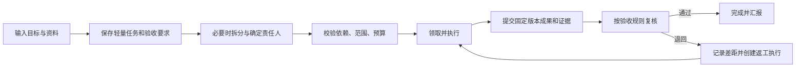

# 岗位协作、任务流程与执行边界

更新：2026-10-14。根据本轮产品研究重写的设计基线；属于待实现方案，不代表当前 P0 已具备。本文定义岗位、任务与协作；副作用、检查点和崩溃处理统一见 [13 重启恢复](13-restart-and-recovery.md)，记忆见 [06](06-memory-and-knowledge.md)。

## 1. 六个对象各自负责什么

| 对象 | 持续多久 | 负责什么 | 不承载什么 |
| --- | --- | --- | --- |
| 岗位 Role | 长期模板 | 职责、输入输出标准、建议能力、验收模板、可读经验范围 | 当前任务状态、进程、个人对话 |
| 长期成员 Agent | 用户保留的身份 | 稳定 ID、岗位绑定、能力引用、预算及私有经验 | 所有任务共享的一整段聊天上下文 |
| 任务 Task | 从交办到验收或取消 | 一个责任人、目标、依赖、输入、成果、验收及交接记录 | 某次进程是否活着 |
| 执行 Run | 完成一次明确执行目标 | 固定输入快照、执行身份、步骤、等待项、预算及最终候选结果 | 业务验收的最终决定 |
| 执行尝试 Attempt | 一段运行器生命周期 | Worker 实例、租约、fencing token、心跳、起止点 | 长期身份、重新定义任务目标 |
| 工具操作 Operation | 一个具体逻辑动作 | 不变的参数、授权、执行状态、结果回执与对账 | 以一个新的模型 callId 推断这是全新动作 |

同一任务可有多次 Run；同一 Run 在兼容检查点恢复时可有多次 Attempt。返工、目标实质改变或主动重新执行创建新 Run；界面重连不创建任何新执行。Operation 在同一逻辑步骤的恢复中沿用 ID，避免将同一次动作当成新动作执行。

岗位和成员配置为文件，任务、运行和尝试为数据库记录。岗位不是常驻服务；成员也不需要独占一个进程。

## 2. 岗位、成员和临时委派

### 2.1 长期岗位配置

岗位模板包括名称、工作目标、职责边界、典型输入、交付格式、验收方法、建议工具与知识范围、协作关系。成员选择模板并可覆盖明确字段；界面显示配置来源。岗位默认值不是授权，实际可用能力取成员绑定、任务范围和当前授权的交集。

同一岗位可有多个长期成员，分别保存私有经验、负载和预算；按任务选择负责人，不因岗位相同自动共享历史。初始可提供助理、调研、编辑、开发、复核等少量模板；用户可以直接交办，无须先建立完整组织。

长期成员的可调度状态为启用、暂停接新任务、归档。暂停接新任务不取消正在运行的工作；归档前要完成或转交待办、停止活跃运行。过去的责任、成果和引用保留，不能删除身份后让历史变成无主记录。

### 2.2 临时子 Agent 的准确含义

临时子 Agent 是为一项子任务装配的执行身份，记录在 child Run 的快照中，不自动创建 `.agents` 长期成员目录。它有父任务/父 Run、岗位模板版本、输入交接包、能力子集、预算及截止条件；没有独立的长期私有记忆写入权。

每次委派创建可追踪的子任务和 child Run。若委派给已有长期成员，子任务责任人是该成员；若使用临时执行身份，子任务的业务责任人仍是委派方，界面同时显示“由临时调研助手执行”。这样临时进程消失后仍有人负责。

“保存为长期成员”是单独的配置动作：创建稳定身份和经过筛选的能力绑定；历史保留原归属，以引用关联。不会直接复制全部临时上下文、批准记录或私有资料。自动建立长期成员仅在用户设置的建岗范围内进行；默认建议并等待确认。

### 2.3 何时允许自动委派

任务范围内的低风险子任务可以按已启用的模板自动拆分；继承总预算、截止时间和最大权限范围，不自动增加额度、连接器或外发权限。超出目标、需要新凭据、改变共享目录或建立长期成员时返回明确待决项。

建议起始限额：工作区最多 3 个同时执行槽，委派深度 2，每个根任务最多 8 个子任务。限额可配置且必须进入持久计数；反复失败不能通过新建子任务绕过。长期成员默认 1 个直接执行槽；临时子运行也计入工作区总并发，父运行等待时释放执行槽。

## 3. 从一句话到可验收任务

纯问答可只有 Conversation。只要开始持久工具执行、后台工作或委派，就自动建立用户可见的轻量 Task；不要求先填写项目表单。未选择项目的任务放在工作区收件箱。需要持续协作时再归入项目，保留原 taskId 和历史。

Task 至少保存目标、当前 revision、一个责任人、执行范围、输入引用、验收条目、交付位置和状态；项目、截止日期和成本上限可采用默认值。简单任务由一名成员直接完成，复杂任务才建立依赖图；父子层级表示分工归属，依赖边表示前置条件，两者不混用。

草稿允许责任人或输入暂缺，并记录具体缺项；进入 Ready 前必须落实唯一责任人及可执行范围。首次使用可自动建立内置默认助理配置，无需让用户先完成组织配置。

可修改的描述不直接替换活跃 Run 输入。补充消息先成为待处理输入；影响目标、收件人、验收或写入范围的变化，应在安全边界停下，形成新任务 revision，并取消或失效旧候选结果和不再适用的审批。

## 4. 任务状态与三类决定

| Task 状态 | 进入条件 | 下一步 |
| --- | --- | --- |
| Draft 草稿 | 目标、输入或责任人尚未准备好 | 用户或成员补齐 |
| Ready 待办 | 输入和依赖满足，可等待调度；具体工具审批可在运行时发生 | Host 原子领取 |
| InProgress 进行中 | 正在执行、等待本任务确认/补充，或交接收尾 | 执行或处理明确待决项 |
| Blocked 受阻 | 当前没有可推进工作，存在具体外部依赖、未知结果或不可恢复故障 | 记录解除条件、下一步负责人和触发方式 |
| InReview 待验收 | 固定版本成果已提交，验收对象完整 | 指定复核者通过或退回 |
| Done 已完成 | 当前 revision 的所有必需验收项通过 | 只读追溯，后续修改新建返工/后续任务 |
| Cancelled 已取消 | 取消请求已处理，受管执行停止，未知副作用已核对或显式关闭 | 保留已发生动作与残留风险 |

暂停以 `schedulingHold` 和暂停原因表达，不另造第二套业务完成状态。请求取消时先记录 `cancelRequested`，UI 显示“正在停止”；不能在进程仍写文件或外部结果未知时直接显示已取消。用户显式关闭无法核对的结果可以结束跟进，但必须保留 Operation 的未知结果记录，不能改成未执行。

三类决定有独立对象和适用范围：

- **计划/范围确认**：接受本轮任务目标、成本或分工；不自动授权工具或验收成果。
- **工具审批**：批准某个具体 Operation 或有限流程授权；不表示动作已执行成功。
- **成果验收**：判断一个确定成果版本是否满足 Task revision 的标准；不追溯授权过去未获准的动作。

计划/范围确认保存为 `TaskDecision`：关联 taskId/taskRevision、提案内容 hash、决定类型、对象版本、决定者/时间与有效期；未决定时有持久待决状态。相同决定幂等，过期 revision 或不同内容拒绝沿用；重启重建同一待确认项。通过只解除该项业务阻塞，是否可调度仍检查其他条件；拒绝保留修改入口。它可以早于 Run 创建，不能复用绑定 Operation 的工具 Approval 作为计划确认。

Task 完成不以所有 child Run 的 Succeeded 数量决定。子任务可能完成了调研，但父任务仍缺汇总、复核或发送确认。

## 5. 领取、执行权与资源写入权

任务责任人是长期业务归属；执行租约是本次 Attempt 的有效写入资格；资源锁限制文件目录、浏览器会话等实际写者。三个概念分别记录。

Host 在一个短事务中检查 taskRevision、assignmentVersion、依赖、调度 hold 和并发/预算额度，再领取任务、分配 Attempt/租约、保存启动事件。一个任务默认最多一个主执行租约；并行工作通过子任务表达。复核读取固定成果，不与开发者共同修改正在生成的版本。

Worker 的所有状态更新和工具请求携带 runId、attemptId、fencing token。旧 Attempt 的迟到提交拒绝进入当前状态；已有外部效果作为异常证据进入对账。**数据库 fencing 无法阻止仍存活的旧 shell 继续写磁盘**，新写者必须等待旧执行器确认停止或资源被真实隔离，详见 [恢复顺序](13-restart-and-recovery.md)。

研发使用独立 worktree 或明确文件所有权，最后由集成负责人合并。同一浏览器登录会话只允许一个操作写者；独立会话才能并行。等待用户或子任务前，保存检查点并释放可安全释放的执行槽和资源锁；仍有未知副作用的资源继续冻结。

## 6. 协作、等待与改派

交接包是结构化记录：目标与 taskRevision、允许范围、输入版本、已确认事实及来源、固定成果版本、已发生的操作回执、未解决问题、下一步、剩余预算与截止条件。使用引用按需读取，不广播成员完整私有聊天。

| 情形 | 持久记录与处理 |
| --- | --- |
| 父 Run 等待子任务 | 保存 child task/run IDs、必需/可选标记、汇总规则、截止时间及下一动作，进入 WaitingChildren |
| 子任务完成 | 结果按 childRunId + resultVersion 去重接收；汇总者读取固定成果，不用父内存快照覆盖新回执 |
| 子任务失败 | 必需项阻塞父任务；可选项可在验收规则允许时继续并标缺项。重试消耗原总预算 |
| 依赖解除 | Host 依据持久条件唤醒并再次校验；不用一个内存回调作为唯一的继续依据 |
| 父任务取消 | 取消其拥有的 child Runs；被多个任务引用的外部依赖只解除本次等待，不擅自取消别人的任务 |
| 改派负责人 | 先停发新动作，保存交接并终止/对账旧 Attempt，再条件更新 assignmentVersion，最后给新成员建 Run |

改派期间显示“正在交接”；责任切换成功前仍保留原责任人，不能先把卡片移动给新成员再放任旧执行器继续写。等待必须有解除条件、下一步负责人和可执行的继续入口，避免任务长期显示“运行中”却没有任何活动。

依赖必须是无环图，新增边时检查；跨项目依赖还要验证输入范围。委派工具只能提出受控请求，Host 检查层级、总额度和有效执行身份后创建记录。

## 7. Run 状态与安全边界

Run 状态采用：`Queued / Running / WaitingApproval / WaitingInput / WaitingChildren / Paused / Reconciling / Cancelling / Succeeded / Failed / Cancelled`。

- 等待状态保存待决对象和可用继续点；等待不靠 Worker 常驻或 HTTP 请求不断线维持。
- 批准、补充输入或子任务满足条件后，经恢复检查进入 Queued；同一 Run 创建新 Attempt。
- Succeeded 表示本次执行已交付候选结果；Task 的验收仍独立进行。
- Failed 只用于已知失败；外部效果不清楚先进入 Reconciling。
- Paused 表示已经到达可保存边界并停止新动作；请求已提交但未停止时显示“正在暂停”。

取消意图一旦保存，在恢复时优先于自动继续。拒绝一个工具可回到模型改用允许的办法，不默认取消整个任务。检查点不兼容、授权已撤销或资源无法确认停写时，给明确原因和接管入口，不偷偷重放旧步骤。

## 8. 产物、复核与完成

Artifact 保存正文或外部结果引用、内容 hash、版本、来源、生成 Run/Operation 和可访问状态。成果先完整落盘并登记，再提交验收；文件存在不等于内容符合目标。外部可变 URL 要保存当时的回执或可验证版本，不能永远用当前页面代替当时结果。

验收记录绑定 `taskId + taskRevision + artifactVersion(s) + criteriaVersion + reviewer + verdict + evidence`。验收可以是确定性检查、指定成员复核或用户确认，由任务模板预先指定；简单草稿不必每次再启动一个复核 Agent。高影响的外发/发布尽量采用独立复核或用户确认。

退回时记录未满足项和下一责任人，Task 回到 Ready 或 Blocked，新建返工 Run；保留上一版成果和验收记录。成果、要求或输入发生影响结论的变化后，旧验收不适用于新版本。未运行的检查标记未验证，不能记为通过。

“完成报告并发送邮件”应拆出交付验收和发送动作。仅配置为通知的汇报失败，不倒改已验收任务为失败；若发送本身是必需交付项，则其结果未明确前该任务不能 Done。SMTP 已接受与最终送达也分别呈现。

## 9. 一个连续例子

用户交办“用指定资料做竞品报告，复核后发给已批准联系人”。系统保存轻量任务和验收要求，助理负责；必要时委派临时调研和数据核对，父 Run 保存等待条件。子任务交付带来源的材料后，助理汇总报告 v1，复核者针对 v1 验收；退回则生成 v2，旧批准不能用于新正文。

发送前生成固定邮件 Operation。若此时服务重启，恢复待审批卡片；若邮件已被服务端接受但本地未收到确认，则进入结果待核对，不自动再发。报告成果仍可查看，界面清楚区分“报告已验收”和“发送结果待核对”。本任务的已验证方法可以提炼为候选岗位经验，经过记忆发布规则后才供其他成员使用。

## 10. 依据与验收入口

长期责任与任务归属参考 [Paperclip](research/products/paperclip.md)；角色、项目与产物体验参考 [WorkBuddy](research/products/workbuddy.md)；子任务、执行协议和持久边界参考 [Codex](research/products/codex.md)、[Pi](research/products/pi.md)、[OpenClaw](research/products/openclaw.md)、[NextCoWork](research/products/nextcowork.md)。借鉴的是机制，未复制上游实现。

[DeepSeek Harness 的实验 Teams](research/deepseek-runtime-recovery.md)进一步说明：持久 task claim、可继续子会话和 inbox 接纳，不自动构成执行租约、故障后的业务续跑或消息处理完成。本方案保留责任、执行资格、等待和验收的独立合同。

下一步验收按 [08](08-delivery-and-validation.md) 与 [13](13-restart-and-recovery.md) 的场景执行；本轮只更新设计，不运行或修改 P0。
