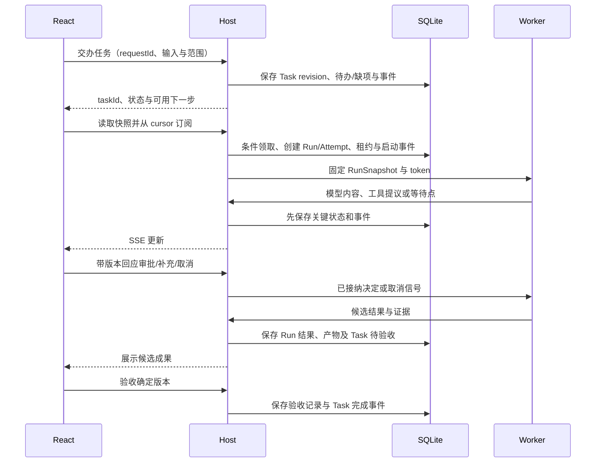

# 前端、Host 与 Runtime 的通信合同

更新：2026-10-14。根据产品研究修订的目标合同；现有 P0 仅有部分探针接口，未实现本文完整业务协议。本轮不改代码。任务语义见 [04](04-agent-harness-and-projects.md)，重启合同见 [13](13-restart-and-recovery.md)。

## 1. 三条通道和各自权威

| 通道 | 方案 | 职责 |
| --- | --- | --- |
| React ↔ Host | 同源 HTTP 命令/查询 + SSE | 交办任务、进度、待决项、成果、验收与接管 |
| Host ↔ MAF Worker | 版本化 JSON-RPC over stdio | 固定输入、运行事件、工具申请、检查点、取消 |
| Worker ↔ 模型 | 具体供应商协议 | 模型请求、内容流、工具提议和用量 |

前端不持有模型密钥、不决定最终状态；Worker 不直写业务数据库。UI 发出“允许”只是提交决定，Host 接纳并核对后才可派发动作。

DeepSeek Harness 的 Web 形态使用 HTTP RPC 与多路复用 WebSocket，NextCoWork 本机使用 Electron IPC；我们借鉴的是命令、观察流、权威状态与运行服务分离。当前任务进度以服务器推送为主，继续采用 HTTP/SSE；以后交互终端或实时屏幕需要双向长流时再增加专用 WS，保持相同业务语义。[DeepSeek 调用链](research/deepseek-web-runtime.md)、[NextCoWork 调用链](research/nextcowork-runtime-communication.md)

## 2. 用户先交办 Task，再观察执行

任务可因缺少模型、目录授权或输入处于草稿/受阻；接口返回具体下一步，不能先显示运行再静默失败。简单任务自动套默认模板，用户无需知道 Run 和 Attempt。

HTTP 接单成功表示请求已持久接纳，不表示模型或工具已成功。关闭页面只断开观察；服务重启后的运行由恢复协调器决定，不能用重新打开 SSE 来触发重放。

## 3. 对外接口以任务和待决对象为中心

以下为设计路径，尚未冻结 OpenAPI：

| 命令/查询 | 必需条件与语义 |
| --- | --- |
| `POST /api/tasks` | 幂等交办，可省略项目；返回 taskId、状态、缺项和可选 runId |
| `GET /api/tasks/{id}` | 当前 revision/负责人、Run 摘要、阻塞、待决项、成果、snapshotSeq |
| `POST /api/tasks/{id}/runs` | 指定执行/返工目的、expectedTaskRevision；正常用户入口由 Host 编排，不任意创建同任务并发主 Run |
| `POST /api/task-decisions/{id}/decision` | taskRevision、expectedVersion、固定提案 hash 与同意/退回；仅处理计划/范围决定，不授予工具许可 |
| `POST /api/tasks/{id}/delegations` | 父 Run、模板/成员、输入与范围、预算；Host 校验后创建子任务 |
| `POST /api/tasks/{id}/handoffs` | 目标成员、expectedAssignmentVersion；先停止/对账旧写者再完成责任切换 |
| `POST /api/tasks/{id}/acceptances` | taskRevision、artifactVersions、criteriaVersion、通过/退回与证据 |
| `POST /api/tasks/{id}/cancel` | 持久取消意图，停止其拥有的执行；返回正在停止或待对账 |
| `GET /api/runs/{id}` | 状态、当前 Attempt、恢复能力、checkpoint 与待决项，不把终态候选当 Task 完成 |
| `POST /api/runs/{id}/pause` | 请求在安全边界暂停，只有完成后状态才为 Paused |
| `POST /api/runs/{id}/resume` | 检查版本、授权、资源、记忆和未决操作；拒绝时返回可操作原因 |
| `POST /api/waits/{id}/response` | 人工补充输入专用，expectedVersion 与响应；Host 校验后持久保存，实质改变目标/范围时转任务修订，不直接改变旧 Run 快照 |
| `POST /api/approvals/{id}/decision` | expectedVersion 与预览载荷 hash；允许一次/有限流程/拒绝 |
| `POST /api/recovery-cases/{id}/resolution` | 记录核对结论、依据与剩余不确定性；不等于无条件重试 |
| `GET /api/artifacts/{id}/versions/{version}` | 读取固定成果版本与可访问状态 |
| `GET /api/conversations/{id}/messages` | 分页历史、分支和已提交水位；纯聊天可不建 Task |
| `GET /api/events?after=...` | 工作区有序事件，可按对象过滤，带续传边界 |

所有变更带 requestId/Idempotency-Key；相同键与相同路由/载荷返回原接纳结果，相同键但参数不同返回冲突。多窗口更新带 expectedVersion；过期审批、旧责任人提交或过期成果验收都返回当前状态和下一步，保留用户尚未提交的输入。

有限流程授权另有版本和撤销入口；“允许此流程”的 UI 要展示实际规则，不由前端根据一次点击拼出任意授权。

## 4. 事件、快照和重连

事件 envelope 包含工作区 ID、eventId、单调 seq、schemaVersion、occurredAt、taskId、runId、attemptId、operationId（适用时）、type 和脱敏 payload。临时执行身份与长期成员 ID 分开，不能根据同一显示名合并。

快照在一致读边界返回 snapshotSeq；续流读取该序号之后的持久事件，再跟随实时提交。前端按 eventId/seq 去重；服务端过滤流可跳过不相关事件，客户端不能将每个整数间隙都当作丢失。cursor 过期时明确要求重新取快照，而不是静默从最新事件继续。

关键状态变更和事件同事务，数据库提交后才发布。文本增量可合批，承诺可恢复的片段也先提交；消息使用 messageId、segmentOrdinal 和状态，避免历史全文与实时片段重复拼接。半条工具参数不能成为可执行调用。

若以后引入低延迟临时帧，必须单独标明 provisional 和基线 revision；它们不能推进持久 cursor，也不能用于完成、审批或恢复。当前基线优先使用已提交数据，具体批量窗口由负载测试决定。

事件最少覆盖任务创建/改派、计划/范围待决与决定、Run/Attempt 启停、工具意图/结果、审批、等待、子结果接收、产物版本、验收、恢复受阻、记忆撤回。大工具输出通过受控文件引用读取，不将任意大 blob 放入 SSE。

## 5. 审批不是一个悬挂的网络回调

Worker 提交工具提议，Host 分配稳定 operationId 并保存参数。需要审批时，先得到可用的 continuation/checkpoint，再提交 WaitingApproval 与待决对象，之后才向 UI 宣称可恢复等待。Worker 无法在此边界保存时，返回明确能力限制，不伪装已完成 checkpoint。

UI 决定经过 Host 条件更新后，旧网络连接可以关闭；派发或恢复由持久状态驱动。服务重启后待决项从数据库重建，客户端重连仅观察。审批的决定、动作完成与成果验收是三种不同事件。

## 6. 内部 Worker 合同

握手声明协议版本、运行器/serializer 版本、支持的 checkpoint 类型与取消能力。Host 拒绝不兼容版本，不让 Worker 启动后再猜字段。

每个请求携带 runId、attemptId、hostEpoch 和 fencing token；工具请求还带逻辑步骤、操作映射和规范化参数。相同逻辑键的重复消息查询原操作，不能因 RPC id 不同就重复执行。Host 持久接纳后返回 ack，Worker 才把边界视为已保存。

Worker 终态只是候选，Host 检查所有已派发操作的结果、文件发布状态与取消意图后收束 Run。已成功工具的结果可以在新 Attempt 回填以完成最终回复；不能因为旧 Worker 超时就清空结果并再调工具。

stdout 只用于协议，stderr 记日志；消息有长度上限，引用有 hash，秘密不进入模型上下文或普通事件。心跳证明进程响应，不证明工作有进展；租约失效也不证明子进程停止，见 [13](13-restart-and-recovery.md)。

## 7. 连接与部署

本地默认 loopback，同源 UI 与 API；远程/Docker 暴露时有所有者认证、TLS 与明确代理配置。Cookie/令牌、Origin/CSRF 与 SSE 认证一致，不将长期密钥写入事件 URL。代理关闭 SSE 缓冲并设置适当超时；深路径部署需验证静态资源、API、cookie 路径和重连地址。

纯 Web 指浏览器界面可独立使用，执行本地文件/终端仍由 Host 承担。未来 Electron 复用同一业务协议，只补原生窗口、启动和系统集成，不另建一套任务/审批状态。
