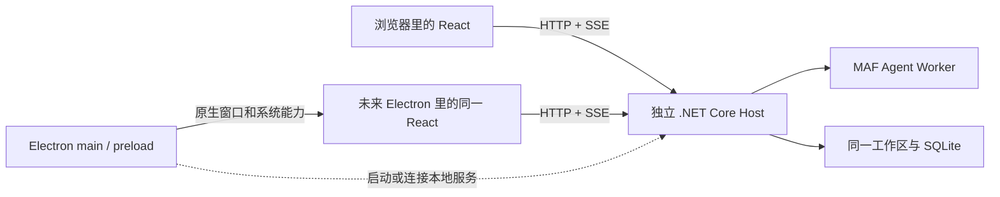

# React 与 Electron 的选择

日期：2026-10-14。讨论后用户已明确选择先 React + 独立 .NET 服务，后续再加 Electron。以下保留选型依据和未来桌面壳的边界。

## 1. 它们可以一起使用

React 是界面开发库；Electron 是桌面应用外壳和运行环境。Electron 的 renderer 仍使用 Web 技术，main 负责窗口与系统集成，preload 提供受控桥接。[Electron 进程模型](https://www.electronjs.org/docs/latest/tutorial/process-model)。

因此候选不是 React 或 Electron 二选一，而是：

- React 浏览器界面 + 独立 .NET 服务。
- 同一套 React 界面 + Electron 桌面壳 + 独立 .NET 服务。

NextCoWork 是 React + Electron，并在桌面主进程内承载本机 TypeScript runtime；它的架构不要求我们把 .NET runtime 搬进 Electron。[NextCoWork 调用链](research/nextcowork-runtime-communication.md)。

## 2. 对本项目的取舍

| 维度 | 浏览器 + 本地服务 | 加 Electron 桌面壳 |
| --- | --- | --- |
| Docker 与远程访问 | 直接适用 | 仍需保留浏览器版 |
| 安装和启动体验 | 需要发布包／启动器，启动后打开浏览器 | 可提供常规安装包并管理本地服务 |
| 文件、网页、终端任务 | 后端可完整承担已授权操作 | 能提供更自然的原生文件选择与桌面集成 |
| 托盘、快捷键、系统菜单 | 需另加轻量系统入口 | Electron 提供相应桌面能力 |
| 长时间后台任务 | .NET 服务独立运行即可 | 必须另行处理关窗、退出与服务生命周期 |
| 视觉效果 | 可实现亮色、半透明与毛玻璃 | 可复用同一 UI，并增加部分窗口级效果 |
| 维护与分发 | 主要维护后端和 Web 资源 | 增加 Chromium/Node 更新、签名、安装、自动更新与兼容测试 |
| 核心 AOT | .NET 核心可独立验证 | 同样可验证，Electron 本身不因此变成 AOT |

表中取舍是针对本项目目标的工程判断；没有做两种发布包的性能或体积实测，不给出未经验证的数字。

## 3. 推荐

**保留 React，保持 .NET 服务独立。第一版继续浏览器形态；面向非技术用户分发时，再加可选 Electron 壳。**

这样先把核心任务可靠性做实；未来桌面包装复用页面、模型配置、任务协议和数据，不另造一套桌面业务后端。若用户以后明确将“一键安装、托盘、系统集成”升为首版必需项，可以把 Electron 包装提前，但不用重写 React。

这里的 HTTP/SSE 不是说必须暴露到公网。桌面模式可连接受认证的 loopback 服务；Web/Docker 连接同协议的远程部署。

## 4. 以后加壳时的边界

Electron main 只处理启动／连接服务、窗口、托盘、原生对话框和深链接。AI 调度、模型密钥、数据库写入、审批规则和任务生命周期保留在 .NET 服务。

renderer 默认无 Node 权限，启用 context isolation 与 sandbox；preload 只暴露明确的桌面能力，不能暴露任意 shell 或通用 IPC。浏览网页的 Agent 会话与产品界面隔离，不把任意网页装进具有本机权限的窗口。[Electron 安全指导](https://www.electronjs.org/docs/latest/tutorial/security)。

要明确“关窗口”“退出桌面客户端”“停止后台服务”三种动作；运行中关闭窗口不能无声杀掉任务。更新也需让 Host 和 Worker 协议版本匹配，在途任务完成或保存恢复点后再替换。

## 5. 什么情况下值得提前加入

当目标用户无法接受手动启动服务、经常需要原生目录授权／系统托盘／快捷入口，且这些摩擦已超过核心功能缺失时，Electron 会直接改善体验。仅为了漂亮界面、模型流式响应或使用本地文件，还不足以要求首版加入桌面壳。
