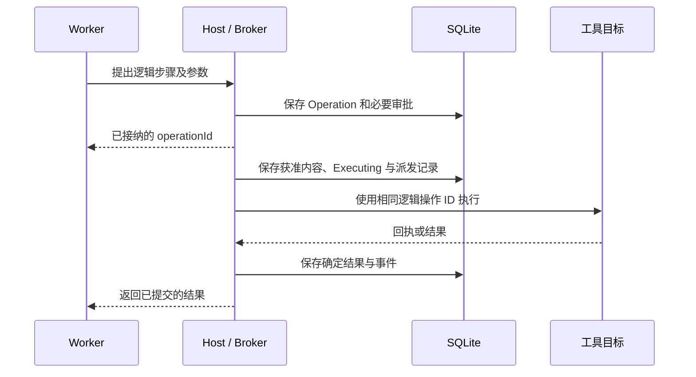

# 审批、检查点与重启恢复

更新：2026-10-14。本文件是恢复机制的规范性设计，尚未实现和通过完整验证；不将 MAF 会话序列化或 macOS AOT 发布成功视为恢复完成。当前实验状态见 [P0 记录](validation/2026-10-14/p0/README.md)。

## 1. 四种恢复分别承诺

| 层级 | 用户期待 | 必须具备的依据 | 不代表什么 |
| --- | --- | --- | --- |
| 历史恢复 | 重新打开还能看到过去内容 | 持久消息、工具结果、成果引用 | 未完成工作会自动继续 |
| 界面重连 | 刷新后看到当前进展与待确认事项 | 权威快照、事件 cursor、持久待决项 | Host 被杀后仍有原来的内存等待者 |
| 运行续接 | 服务重启后从安全点继续 | 兼容 checkpoint、输入快照、有效授权、执行归属 | 可以从半条模型流逐字继续 |
| 副作用对账 | 不漏掉或重复已发生的动作 | Operation 账本、回执、目标系统查询或幂等合同 | 所有外部系统都支持恰好一次执行 |

UI 只在相应级别通过验证后宣称可用。检查点缺失或不兼容时保留历史和成果，提示需要重新安排执行，不能把“能打开旧聊天”写成“自动恢复成功”。

## 2. 由谁掌握事实

Core Host 是主数据库、调度、授权、工具副作用和业务事件的唯一写入入口。Worker 可提交检查点与结果候选，但不自行领取任务或把 Task 标为完成。工具 Runner 也不能直接决定业务状态。

一个工作区只允许一个 Host；启动时先取得工作区进程锁，再建立新的 hostEpoch。租约包含 hostEpoch、attemptId、fencing token、期限及所属资源。所有变更检查当前 token；旧 Worker 返回的消息保留为诊断或对账证据，不覆盖当前执行。

进程锁、租约和文件/网络隔离解决不同问题。租约失效只证明失去提交资格；它不能撤销已经交给操作系统或远端的工作。新写者启动前，必须确认旧写者停止，或工作目录/执行器已隔离；无法确认时冻结受影响资源，允许无关任务继续。

## 3. 持久记录的最小集合

| 记录 | 主要内容 |
| --- | --- |
| RunSnapshot | taskRevision、assignmentVersion、身份/岗位/能力版本、模型与运行器版本、允许范围、预算、输入和上下文引用 |
| Attempt | runId、序号、hostEpoch、Worker 身份、租约、开始/结束原因、恢复来源 checkpoint |
| Checkpoint | schema/runtime/serializer 版本、runId、逻辑 step、已提交消息水位、工具调用与 operationId 映射、等待项、预算水位、内容 hash |
| Operation | 稳定逻辑键、参数及正文 hash、工具/目标/策略版本、授权、执行分类、状态、结果/回执、对账记录 |
| Approval | operationId、审批内容版本、预览 hash、决定、决定者、范围、有效期、撤销/失效原因 |
| TaskDecision | taskId/taskRevision、计划/范围类型、固定提案 hash、待决版本、决定与有效期；可以没有 Run，不能授予工具权限 |
| Wait | 类型、关联工具审批/任务决定/输入/子任务、解除条件、下一动作负责人、超时策略 |
| RecoveryCase | 不确定原因、已有证据、资源冻结范围、允许动作、人工核对结论和审计 |

敏感凭据仅保留 secretRef。Checkpoint 可存数据库 blob；大对象使用带 hash 的不可变文件引用，先完整发布文件、再在数据库登记。只有数据库已确认引用且内容校验正确的检查点可用于恢复。

RunSnapshot 固定的是可重现输入，不是不可撤销权限。每次恢复重新核对当前授权、禁用工具和已撤回记忆；失效范围不能因旧快照而继续生效。

## 4. 工具动作先记意图，再发出

模型 callId 是协议相关标识；Host 的稳定逻辑操作键由 Run、步骤和工具调用槽位关联，恢复时重用已保存映射。相同键、相同参数返回原状态或结果；相同键但参数/目标不同则冲突。重跑模型产生新 callId，不能绕过未对账操作再发一个“新动作”。

Operation 状态：`Proposed → PendingApproval / Authorized → Executing → Succeeded / Failed / UnknownOutcome`。审批拒绝为 Rejected；未派发且确认无需再执行可 Cancelled。Failed 必须有确定失败依据；部分生效且尚不清楚时使用 UnknownOutcome，并记录已知部分。

同事务提交关键业务变更和可恢复事件；事务内不等待网络、人工审批或长时间文件操作。工具请求被数据库接纳，不代表已派发；Executing 在实际发出前先落盘，因此重启后它可能“尚未发出，也可能已完成”，必须按工具合同核对。

Host 只有在派发记录确认提交后才能调用目标。提交结果不确定或数据库不可写时停止新派发，并通过读回确认状态。不能为了继续执行把持久失败降级成内存记录。

这条写前屏障是 Host 的不可绕过规则。DeepSeek Harness 默认 Web 组合在关键边界 flush，而其最小 SDK 组合和自定义 patch 可能没有同等策略；它在缺失工具回执时写入未知结果，也没有把历史恢复等同安全重跑。[固定源码研究](research/deepseek-runtime-recovery.md)是设计依据，本项目仍需独立验证。

## 5. 审批如何跨重启保持有效

单次审批绑定 `operationId + toolVersion + normalizedArgumentsHash + artifactContentHash + targetScope + policyVersion`。预览来自这份不可变载荷；用户决定与相应状态/事件在同一事务提交。重复决定返回已保存结果，决定冲突返回最新状态，不重复派发。

等待审批前必须形成可用的工具边界 continuation：规范化的工具调用、MAF 所需会话状态及工具结果回填位置。如果运行器在这一点无法保存，就不能展示为“已保存、重启可继续”；应停在可支持的边界或显示恢复能力受限。审批记录本身仍必须持久保存。

重启后 UI 从数据库重建待审批卡片，不寻找旧 Promise。已批准但未执行的操作重新检查内容、有效期和撤销状态；全部匹配才排队。参数、收件人、文件内容或目标变化时废止旧审批；原 Operation 载荷不修改，确认未派发后将其取消，再以显式替代关系创建新逻辑 Operation 供确认。已执行或结果未知的旧操作必须先对账，不能借替代操作绕过这一限制。

有限流程授权是可重复匹配的范围规则，单次审批是一次具体许可。给某封邮件点“允许一次”不会生成任意收件人授权。高风险动作依旧逐项检查，角色身份和插件声明不能扩大范围。

## 6. 重启后的固定处理顺序

1. **锁定工作区并保持调度关闭。** 校验数据库/schema、工作区标识和运行版本；迁移失败或主数据损坏时进入可查看的恢复模式，禁止执行。
2. **使旧提交资格失效。** 建立新的 hostEpoch，标记未结束 Attempt 为待核查；检查受管 Worker/Runner 的真实进程身份，不能仅凭可能重用的 PID 杀进程。
3. **确认写者状态。** 终止仍由本产品持有的旧执行器并等待确认，或保持其资源冻结。若无法证明已停止，不启动冲突写者；不自动清空全部资源锁。
4. **对账文件发布和工具操作。** 先核对回执、最终文件 hash、暂存操作和外部状态；结果不明进入 RecoveryCase。未知操作未收束前，不把整个 Run 自动重放。
5. **恢复等待对象。** 还原计划/范围 TaskDecision、工具审批、人工输入、子任务等待和持久取消/暂停意图；子结果按版本去重合并。决定重新核对 revision、内容和有效期；通过记录不能因重启丢失，也不能因重启扩大范围。
6. **检查是否可续接。** 校验检查点与运行器兼容、输入版本、当前能力与权限、记忆撤回、预算、依赖和资源。满足条件才为同一 Run 建新 Attempt。
7. **开放已确认安全的调度。** 保留受阻资源与任务说明；无关工作可继续。发布恢复摘要，列出已恢复、等待用户和结果待核对，不统一显示“恢复完成”。

预算不随 Attempt 重置；已经提交的用量不重复入账。崩溃前费用尚未返回时保留估算或未结算预留，再对账；未知费用不是零费用。

## 7. 各崩溃窗口的决定

| 重启前最后确认的位置 | 重启后的决定 | 用户看到什么 |
| --- | --- | --- |
| 任务/Run 已入队，尚未领取 | 校验依赖与范围后可重新调度 | 待办/排队 |
| 领取成功，尚未有工具派发 | 确认旧 Worker 已停止后，从兼容检查点新建 Attempt | 已恢复，正在继续 |
| 模型流中断，未形成完整消息/工具调用 | 保留已提交历史，标记这次响应不完整；在无未决操作前提下重试模型步骤 | 响应中断，可继续；可能产生额外模型费用 |
| 等待审批 | 重建同一待决对象；不执行工具 | 等你确认 |
| 已批准、未开始派发 | 重验批准快照和当前策略；匹配才排队 | 已批准，等待执行 |
| Executing、无确定回执 | 按下节工具类型对账，禁止通用盲重试 | 结果待核对 |
| 工具 Succeeded 已落库，最终模型回复未完成 | 复用工具结果收尾，不再执行工具 | 动作已完成，正在整理结果 |
| 产物文件已发布，业务登记未提交 | 按发布意图和 hash 补登记；未能确认者隔离为未登记文件 | 正在恢复成果 |
| Run 已成功，Task 尚未验收 | 恢复固定成果和待验收项，不重跑 Run | 待验收 |
| 父 Run 等待 child | 恢复持久 child 关系与结果水位，先核查 child 再汇总 | 等待子任务/可继续汇总 |
| 已请求取消 | 只停止与对账，不自动重新排队 | 正在停止/结果待核对 |
| checkpoint 损坏或版本不兼容 | 尝试已保留的兼容运行器；不可用则阻塞并提供新 Run 接管方案 | 需要重新安排执行，历史和成果保留 |
| 从旧备份恢复 | 进入恢复演练/只读检查，禁止自动外发；核对备份后可能发生的动作 | 等待确认恢复范围 |

安全继续的判断以持久事实为准。旧文件不存在不普遍证明动作没有发生；只有独占、完整可查询且已确认无旧写者的本地工具，才能把该查询作为重试依据。

## 8. 不同工具采用不同恢复策略

| 工具合同 | 示例 | 允许的恢复动作 |
| --- | --- | --- |
| 明确只读且无业务副作用 | 读取文件、查询状态 | 有限重试；仍检查预算、范围和输入是否改变 |
| 目标提供已验证的幂等键合同 | 支持同键查结果的 API | 用同一键与同一参数查询/重试；遵守去重有效期，超出有效期降级核对 |
| 目标可按稳定资源标识查证 | 文件发布、创建可检索外部记录 | 读回核对内容、版本和归属，确认后补记结果 |
| 无可靠去重或查询 | 部分 SMTP/插件/终端脚本 | 不自动重发，由用户核对；明确提示可能已生效 |

通用 shell 不能仅因命令文本相同就宣称幂等。可查询也不代表查询结果足以证明从未执行；适配器需定义证据强度。人工核对记录结论、依据和时间；允许重新执行应是新的明确命令，并保留与未知旧操作的关联。

SMTP 固定 Message-ID 只帮助跟踪，不保证去重。SMTP 接受、最终送达和用户已阅读不是同一个状态。

## 9. 文件、回执与检查点的发布

本地结果采用“数据库写发布意图 → 同卷暂存文件 → 完整写入/刷盘 → 原子发布不可变最终路径 → 重读 hash → 数据库确认”的流程。目录同步与原子替换的实际保证在各平台分别验证，跨卷移动不能当作原子提交。

- 最终文件已存在且 hash 匹配：补登记，不再写一份。
- 最终文件已存在但损坏或内容不同：隔离冲突并阻塞，不覆盖它来伪造成功。
- 只有暂存文件：按意图校验；可证明完整才发布，否则保留诊断后安全清理/重建。
- 找不到文件：先确认没有活跃写者，再按操作类型决定是否可重做。

工具回执一旦确定成功就独立保存；即使 Worker 生成结尾文字失败，工具状态仍保持成功，Run 可以继续收尾。不能把“最终回复失败”回写成“工具未执行”。

文件正文与数据库登记不做双主；发布日志只是跨介质的恢复依据。孤儿文件不能直接作为可交付成果，垃圾回收也不能删除仍被 checkpoint、未知操作或历史成果引用的版本。

## 10. 暂停、取消、关闭与升级

关网页只断开观察。暂停要求停在可保存边界，取消要求停止新动作并处理在途效果；进程退出不等于对外动作撤回。父任务取消传播至其拥有的 child Runs，不能取消共享依赖的其他任务。

正常停机先停止接单/派发，保存可保存状态，等待或终止受管执行器，记录尚未核对的动作，最后释放工作区锁。超出停机时间限额时保留明确的中断/未知状态；下次按同一恢复流程处理。

Worker 升级先检查协议和 checkpoint schema。能够保留旧版本时让旧版本收尾；不能兼容时明确阻塞并构造交接包。新 Run 不重演已经确定的副作用，也不自动继承旧载荷的批准。

## 11. 必须通过的故障验收

应覆盖：审批前后杀进程、动作发出前后杀进程、工具成功后结尾失败、回执半写、数据库提交失败、父子同时完成、旧 Worker 迟到、取消后重启、插件/模型版本变化、记忆撤回后恢复、磁盘满、旧备份恢复和幂等键过期。

检查对象同时包括数据库状态、真实文件/外部效果、重复动作次数、可用的 UI 下一步和未结算预算。每项记录固定依赖和原始日志；未跑标未验证。详细阶段与覆盖矩阵见 [08](08-delivery-and-validation.md)。

P0 的回执最终文件半写、工具成功但 Run 收尾失败两项缺口已修复并完成限定配置验证，见 [复审交付](validation/2026-10-14/p0/review-and-delivery.md)。其证据限专用文件回执与实验运行器，不等于完整 Task/Attempt/lease、外部动作或记忆恢复已经实现。本合同的生产实施与剩余门槛见 [14 生产方案](14-production-implementation-plan.md)及 [15 工作包](15-production-work-packages.md)。
