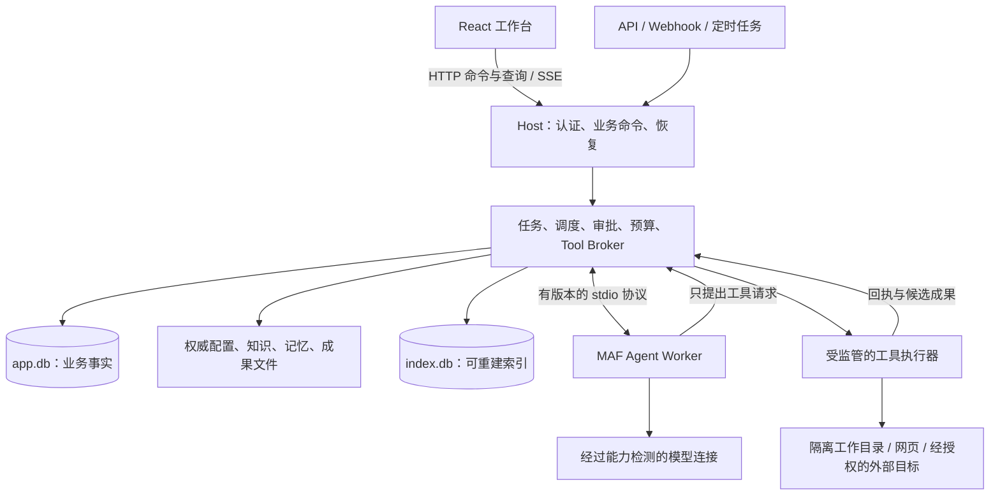

# 生产级实现方案

更新：2026-10-15。状态：**已开始分阶段实现，首个本地闭环完成**；范围与证据见 [18 交付记录](18-production-m1-delivery.md)。依据是当前设计文档和本地提交 `642b2e8` 的 P0 复审结果，不继承本项目更早的规格或实现结论。工程目录暂用 Career，未确定对外产品名。本文的完整容量、支持矩阵和后续发布策略仍为计划，不能把本地子项通过当成全部验收完成。

本方案负责“如何实现、按什么顺序交付、凭什么放行”；对象语义以 [04](04-agent-harness-and-projects.md)、存储权威以 [03](03-storage-and-workspace.md)、记忆规则以 [06](06-memory-and-knowledge.md)、恢复合同以 [13](13-restart-and-recovery.md) 为准。可分派的工作包见 [15 实施任务清单](15-production-work-packages.md)，已有验收场景继续使用 [08](08-delivery-and-validation.md) 的编号。

## 1. 交付目标与当前起点

生产首版应让一个所有者在自己的工作区中，完成办公、研发、经营各一条真实业务闭环：交办任务、查看过程、处理审批、暂停或接管、验收固定版本成果，并在应用或机器重启后恢复一致状态。配置、知识与已发布记忆可检查和迁移；任务和执行事实有可靠备份；安装、升级、故障诊断无需编辑源码。

继续采用 `.NET 10 + SQLite + Microsoft Agent Framework + React`：业务 Host 以 Native AOT 发布，MAF/模型 SDK 留在普通 .NET Worker，浏览器使用同源 HTTP/SSE。第一版是单所有者、单工作区单 Host、有限本地并发；Electron、通用桌面控制、多租户、跨机器调度和分布式存储放在后续版本。

| 已有基础 | 如何进入生产实现 | 尚需完成 |
| --- | --- | --- |
| P0 原生 Host、MAF Worker、React、SQLite、stdio/SSE | 保留为独立实验和黑盒回归参照；按正式合同迁入生产工程 | 正式 API、完整身份认证、真实模型、可安装发布包 |
| 审批、专用回执、半写隔离、取消和收尾恢复 | 复用已验证的原则、故障窗口与断言；逐项迁入通用 Operation 层 | 完整 Task/Attempt/租约、通用成果、外部系统对账 |
| 三配置各 23/23、16 项针对性测试、4 组 smoke | 作为已有实验子集证据 | Windows、原生 Linux x64、真实模型、真实外部效果、完整 UX/运维 |
| 01–13 的产品合同与研究 | 形成版本化接口、数据库约束、状态迁移和验收用例 | 不能把目标合同直接标成已实现 |

P0 的数据库、测试凭据、故障开关和固定模型不能成为生产默认配置。生产工作区从正式 schema v1 建立，不自动导入实验数据；如以后需要导入，另做只读导出和显式转换工具。[P0 的实际证据与限制](validation/2026-10-14/p0/review-and-delivery.md)保持独立。

## 2. 工程与职责边界

```text
src/
  Career.Host/             HTTP、身份入口、服务生命周期、组合根
  Career.Core/             业务对象、命令、调度、策略、状态迁移
  Career.Infrastructure/   SQLite、文件发布、凭据、进程监管、系统适配
  Career.Contracts/        HTTP/事件/Worker DTO、错误码与 schema 版本
  Career.AgentWorker/      MAF、模型适配器、上下文组装与运行安全点
  Career.ToolRunner/       工具执行入口、隔离环境接入、解析/浏览器适配
apps/web/                  React 工作台
tests/                     规则、存储、协议、进程故障、UI 与真实连接验证
packaging/                 Windows/macOS/Linux/Docker 发布与诊断
experiments/p0/            原实验及证据复跑入口
```

上述目录中 Host/Core/Infrastructure/Contracts/AgentWorker、React、tests 与 packaging 已建立；ToolRunner 和后续模块尚未创建。Core 后续按 Workspace、Tasks、Agents、Conversations、Execution、Capabilities、Knowledge、Memory、Notifications 划分责任；不为每个实体建立一个服务、程序集或通用仓储。外部依赖只能通过明确适配边界进入，Core 不引用 MAF 和供应商 SDK。



Host 是业务数据库的唯一写者。Worker 不能领取任务、改变审批、登记成功或决定 Task 完成；工具与模型输出只产生待校验的事件和候选结果。ToolRunner 无权使用主数据库或完整凭据库。

Host 的 AOT 门槛从第一个工程批次开始：显式 DTO、System.Text.Json 源生成、参数化 SQL；新增认证、OpenAPI、JSON Schema、SQLite 原生库和全球化功能都必须在发布产物中实测。P0 的 `InvariantGlobalization` 不能直接当作中文格式、时区和定时任务的生产结论。官方兼容表对认证、Session 等功能有单独限制，因此不能先依赖普通运行时功能，临近发布才处理 AOT。[ASP.NET Core Native AOT](https://learn.microsoft.com/en-us/aspnet/core/fundamentals/native-aot?view=aspnetcore-10.0)。

## 3. 任务、执行与成果的正式模型

| 对象 | 生产实现要求 | 必须守住的边界 |
| --- | --- | --- |
| Workspace/Project | 工作目录、配置版本、输入范围、项目关系 | 单工作区单 Host；项目目录配置不覆盖数据库业务状态 |
| Role/Agent | 模板版本、稳定成员、私有范围、能力绑定 | 岗位名称不授予权限；临时执行身份不自动成为长期成员 |
| Task/TaskRevision | 目标、唯一责任人、验收条目、预算、输入引用和 scope | 修改目标、收件人或写入范围创建新 revision，不能改活跃 Run 快照 |
| TaskDecision | 固定计划/范围提案、hash、决定和有效期 | 与工具批准、成果验收分开 |
| Run/Attempt | 固定任务快照；每次实际启动有独立 Attempt、hostEpoch 和租约 | 同 Run 安全续接创建新 Attempt；返工或改变目标创建新 Run |
| Operation/Approval | 稳定逻辑动作、规范参数、授权快照、派发和回执 | provider callId 不能成为唯一操作身份；批准后不得扩展载荷 |
| Artifact/Acceptance | 不可变版本、hash、来源、检查证据与验收人 | Run 成功表示提交候选结果；Task Done 绑定当前 revision 的完整验收 |
| Wait/RecoveryCase | 等待对象、解除条件、下一责任人、恢复动作和证据 | 不能只显示“运行中”而没有可继续的原因和入口 |

状态迁移统一由 Host 命令处理器验证，以条件更新和数据库约束实现；UI、Worker、插件均不能直接设置状态。状态变化、相关事件、幂等接纳记录在同一事务提交。

P0 到生产的状态映射必须显式实现：P0 `UnknownOutcome` 属于生产 Operation/RecoveryCase，Run 使用 `Reconciling`；`FinalizationPending` 表达为收尾阶段及暂停/恢复原因，保留已成功工具账本；P0 `Denied` 不能直接变成“整个任务取消”，生产版工具拒绝后允许模型在剩余授权内调整方案。等待审批、补充输入和子任务分别保留持久对象。

候选成果必须先完整发布并登记，再进入 InReview。退回生成新 Run 和新成果版本，旧成果保留；发送本身属于必需交付时，未确定发送结果不能 Done。仅用于通知的邮件失败不倒改已完成业务任务。

## 4. 数据、事务与持久性

关系表采用 [03 的表组](03-storage-and-workspace.md#5-sqlite-数据模型与并发)，按交付阶段迁移，不一次创建全部空表。至少建立以下约束：每 Task 一个当前责任版本、一个有效主租约；每 Run/step/tool-slot 一个逻辑 Operation；每发布/通知/定时发生实例一个去重键；验收引用实际存在的不可变版本。

- `app.db` 保存任务、消息、审批、Operation、预算和恢复事实，启用外键、WAL、`synchronous=FULL` 和短事务；受控写入队列设有背压，事务中不等待网络、模型、人工输入或文档解析。
- 配置、知识原件、发布记忆与成果正文继续由文件负责。写入走“持久化意图 → 同卷暂存 → 完整性校验/刷盘 → 原子发布 → 重读 → 数据库确认”，失败后按原 Operation 对账。
- `index.db` 和提取缓存可重建，损坏时允许降级为无检索/只读浏览；绝不能把主数据库当缓存删除。数据库与文件的联合一致性由恢复流程负责，不承诺跨介质原子事务。
- 配置外部编辑先校验新版本；错误文件保留磁盘内容并继续使用上次有效配置，界面说明当前版本。监听事件丢失由启动扫描和周期扫描补偿。
- schema 迁移有顺序号、checksum 和执行记录，迁移前备份；失败进入维护/恢复状态。生产代码不能悄悄自动降级写入旧 schema。

已确认状态的事件采用单调序号。任务快照在一致读事务中返回对应水位，客户端从该水位补读，避免“先拉快照再订阅”漏事件。全文/向量索引另有构建代次和水位；索引版本不改变业务事实。

SQLite WAL 仍只有一个并发写者，且要求参与者位于同一主机，不能据此支持任意共享网络盘。保留 P0 的独立进程锁自检，并增加目标存储介质和数据库写锁验证；不通过则拒绝开放调度。[SQLite WAL](https://sqlite.org/wal.html)。

## 5. 调度、租约与重启恢复

首次交付默认一个执行槽；在租约、预算和资源锁通过后支持三个并发 Run，用户可以下调。等待用户、子任务或配额时释放可安全释放的执行槽；仍有未知效果的资源保持冻结。调度顺序考虑优先级、依赖、截止时间与等待时长，避免后台任务饿死交互任务。

一次领取在短事务中完成：校验 Task revision/assignment、依赖、hold、授权及预算 → 条件领取 → 建 Attempt/租约 → 预留额度 → 写启动事件。事务提交后才启动 Worker。恢复需同时处理“已领取但未启动”和“已启动但未登记握手”的窗口。

Worker 和 Runner 更新携带 `runId/attemptId/hostEpoch/fencingToken`。重用 PID 不能被当成旧进程身份；监管记录包括启动标识、进程组或容器 ID、工作目录与归属。Windows 使用受控进程树机制，Unix 使用进程组；不把它们当作恶意代码沙箱。

重启过程固定为：

1. 校验工作区、数据库、磁盘与锁，进入可读但不派发的恢复模式。
2. 建新 hostEpoch；核实旧 Worker/Runner 已停止或资源已真正隔离，无法确认就冻结相关任务。
3. 恢复未完成文件发布，核对 Executing/UnknownOutcome 的真实目标和回执。
4. 先恢复取消/暂停意图，再恢复计划确认、工具审批、输入与子任务等待。
5. 校验 checkpoint 版本/hash、当前授权、记忆撤回、预算和依赖；不兼容则生成可人工处理的 RecoveryCase。
6. 仅为可证明安全的项重新排队；恢复事件持久化后通知 UI。

MAF 会话作为不透明数据保存，外层封装记录 adapter/框架/provider 配置版本、上下文清单和已消费工具水位。默认只恢复到经过验证的兼容版本；升级不能随意更换 provider 再加载旧会话。官方也要求保存完整 session 并按原 agent/provider 配置恢复；这不替代业务审批和副作用账本。[MAF 会话存储](https://learn.microsoft.com/en-us/agent-framework/agents/conversations/storage)。

暂停请求先持久化，到安全点并停止新派发后才显示已暂停。取消不回滚已发生效果，无法核对的操作保持未知。恢复工作台支持重读目标、补齐凭据、修正配置、兼容续接、导出交接包和显式关闭跟进；“关闭跟进”保留原未知事实，不伪造未执行。

## 6. 真实模型、上下文与费用

连接、模型、适配器分开建模。生产首版覆盖现有设计中的 OpenAI Responses、OpenAI 兼容 Chat Completions、Anthropic Messages、Gemini 原生协议；Ollama 原生能力按实际需要加入。先完成一条真实连接的完整任务，再扩展协议，每条发布支持的连接独立留证。

能力探测按“连接＋模型＋适配器版本”保存：认证、文本/流式、工具 schema、连续工具循环、结构化输出、取消、多模态、usage、Embedding。字段分为已验证、声明支持、不支持、未知；连接健康不代表工具能力可用，缺项在任务调度前阻塞或明确降级。

模型请求固定 system/task/工具/配置版本和 `ContextManifest`；上下文组装先做权限与撤回过滤，再做相关性和 token 预算分配。压缩摘要要保留来源指针与水位，不覆盖原消息，也不能变成权限或事实。超长历史采用分页、摘要和检索；终端/网页原文通过引用按需读取，不无界灌入模型。

费用账本以每次 provider 请求为单位持久保存：请求前预留、结束后按实际 usage 结算，异常中断保留估算/未知。迟到 usage 只更新原账项；重启、子任务重试或模型重试不重置额度。模型币种和计价版本记录在账项中，未知价格不能显示为零费用。硬限制同时使用 token/调用次数/并发/时长；金额上限无法精确预估时保守保留预留额度并停止新派发。

每次模型请求先由 Host 接纳稳定 call ID 和预算预留，Worker 获得本次 Attempt 的调用许可后才请求供应商；重试新建调用账项并关联原请求。流式消息按批次保存已提交水位，中断后未完整提交的回复标记为截断，不能把半截工具参数重新执行。模型网络超时、工具执行超时和整个任务截止时间分别管理。

仅明确可重试的读取或已知未产生效果的请求采用有上限的退避；模型超时后若存在未决工具，先对账。供应商端取消不保证费用为零，界面分别展示已确认、估算和待结算用量。

## 7. 工具执行、审批与隔离

每个工具声明版本、输入/输出 schema、权限、资源类型、效果类别和恢复能力。恢复能力只允许三类：只读可重做；有可靠幂等键或查询依据的写操作；不可可靠核对的写操作。能力声明还需执行适配器和测试证据支持，不能信任任意 MCP 工具自行声称“幂等”。

Broker 按以下顺序处理：校验执行资格 → 校验 schema/参数与资源 → 形成稳定 Operation/规范载荷 → 计算授权和预览 → 持久化审批/派发意图 → 再次检查即时撤权 → 派发 → 保存回执 → 校验候选成果。批准绑定正文、收件人、目标、输入版本、工具版本和作用域；变更后原批准失效。固定流程授权也有对象范围、额度、有效期和撤销机制。

| 执行能力 | 建议实现 | 生产放行要求 |
| --- | --- | --- |
| 文件读取/发布、文档转换 | 显式资源 ID、受限目录、不可变成果；复杂解析放 Runner | 测试穿越、符号链接/Windows reparse point、大小写及路径竞争；禁止访问凭据和主库目录 |
| 研发修改、Git、终端 | 每 Task 独立 worktree/工作目录；可信用户代码可显式启用本机模式；不可信执行使用容器隔离 | 挂载最小工作目录，不挂主工作区/密钥/宿主 socket；限 CPU/内存/时长；保留真实退出码和截断日志；确认旧写者退出 |
| 网页与浏览器 | 独立浏览器 profile，按会话单写者；下载进入隔离暂存 | 对所有请求/重定向/DNS 解析实施目标限制；账号与 cookie 按连接隔离，外发动作经过审批 |
| MCP | stdio 与 Streamable HTTP 适配；工具清单固定快照；按连接注入凭据 | 元数据变更触发重新检查；断连的写操作进入对账；新工具不自动获权；远端实际效果不因本地进程结束而撤销 |
| Skills/插件 | 固定版本的指令包、声明配置与受控进程入口 | 安装不授予工具权；不支持的 hook/UI/权限能力明确标注；保留旧版本供已有 Run 使用 |
| HTTP/SMTP/外部连接器 | 各目标提供独立 EffectAdapter 和 RecoveryAdapter | 保存目标查询依据；无查询/去重保证时未知结果不自动重发 |

本机模式明确只适用于用户信任并授权的代码。没有可用隔离能力时，不可信脚本功能显示不可用，不能悄悄回退为任意本机执行。容器本身也需固定镜像、最小挂载、非 root、网络策略和资源限额；同一用户权限下的普通子进程不提供安全隔离。

第三方网页、资料、工具描述和检索结果视为不可信内容，不能修改授权策略或指示系统导出凭据。网络出口策略同时覆盖模型自定义 endpoint、网页、MCP/OAuth 元数据和重定向；私网/回环地址默认拒绝，管理员明确配置的本地模型连接是按目标授权的例外，不能变成任意 URL 代理。[MCP 安全建议](https://modelcontextprotocol.io/docs/2025-11-25/tutorials/security/security_best_practices)、[OWASP SSRF 防护](https://cheatsheetseries.owasp.org/cheatsheets/Server_Side_Request_Forgery_Prevention_Cheat_Sheet.html)。

## 8. 身份、凭据与对外入口

loopback 只是监听边界，生产版所有读写、成果下载和 SSE 都要验证所有者身份。建议本机启动器生成短期一次配对码，浏览器完成绑定后使用短期访问凭据；远程/Docker 首次安装通过部署端设置所有者凭据，不开放匿名管理接口。

优先验证 AOT 支持的 JWT 验签路径；浏览器访问令牌仅放内存，SSE 用可携带认证头的流式请求。刷新凭据采用 HttpOnly Cookie、服务端可撤销记录和轮换，远程连接必须 HTTPS；本机明文 loopback 的安全限制单独列明，不能宣称抵御同机恶意同权限进程。登录、配对、刷新、退出、撤销和账号恢复都需限流和测试。令牌签名、随机数及密码哈希使用成熟实现，不自创密码学。

严格验证 Host/Origin、反向代理信任范围和 CSRF；令牌不进入 URL、日志或 LocalStorage。CSP、Markdown/HTML 清理、下载 Content-Disposition 与 MIME 策略防止不可信成果变成同源脚本。外部 API 使用独立可撤销、有限 scope 的凭据，不能复用浏览器全权会话。

`vault.enc` 保存加密秘密，macOS 主密钥使用 Keychain，Windows 使用系统保护的凭据设施，Docker 由部署 secret/挂载密钥提供；具体后端通过 AOT/权限/迁移验证后冻结。没有密钥就保持连接不可用，不能生成新密钥覆盖旧库。Worker/Runner 只取得本次所需连接凭据，进程环境不继承整个宿主环境；诊断包不默认导出密钥、正文或用户文件。

MCP OAuth 用经过验证的客户端实现，按连接和资源隔离凭据，遵守受众、scope、state/PKCE 与回调校验；不把 Host 的访问令牌透传给外部服务。具体协议版本固定在连接能力记录中。[MCP Authorization](https://modelcontextprotocol.io/specification/2025-11-25/basic/authorization)。

## 9. 岗位协作与任务编排

一名责任 Agent 先直接执行；只有存在可独立验收的子工作时才委派。委派请求包括目标、输入版本、允许能力、预算、期限、必需/可选标记和成果要求；Host 检查父任务范围、层级上限、依赖无环和总预算后建立 child Task/Run。

父等待由数据库条件驱动，按 `childRunId + resultVersion` 合并一次；子失败、超时和改派都有持久下一步。父取消只传播给所拥有的子任务，共享依赖只解除等待。建议首版最大委派深度 2、总活跃 Run 3，属于可配置且受预算限制的默认值。

交接包引用已确认事实、成果、回执、未决操作、剩余额度和下一步，不复制完整私有聊天。改派必须先暂停派发、保存交接、停止/隔离旧写者并对账，然后改变 assignmentVersion，再建立新 Run。代码工作由独立 worktree 汇入可审查差异；浏览器同一登录会话只有一个操作写者。

## 10. 知识、检索与长期记忆

知识导入按持久作业执行：登记原件/hash/授权 → 限大小与格式 → 解析/OCR → 固定分块版本 → Embedding → 构建索引 → 原子切换可用代次。失败可重试原作业，删除、替换和取消对旧作业有版本检查，不能让迟到索引复活已删除资料。引用必须能定位原文件版本与页码/段落；解析失败不伪装为空白内容。

初版检索使用 SQLite FTS5 加向量检索，在现有 10,000 分块目标下先实现可验证的精确向量检索，放在可取消的索引/检索执行路径中；通过基准后再决定是否需要 ANN，避免先引入未验证的原生扩展。先按 scope/文档版本过滤，再做文本与向量召回、融合和可选重排。中文分词、跨语言、无答案和矛盾来源列入质量集；检索得分不代表事实确定性。

Embedding 连接、模型、维度、预处理或分块规则变化生成新索引代次；旧代次在新代次可用前继续服务，但不得混算不同向量空间。存量可见性和撤回规则在查询端即时生效，不能等重建完成才撤权。

记忆分四层：运行上下文、经历摘要、长期事实/经验、知识资料。候选先记录来源、证据、scope、版本和敏感性；Host 经过发布规则生成不可变正文与清单。共享是显式范围变更，岗位名称相同不等于私有记忆共享；临时子 Agent 只接收当前任务允许的交接资料。

热/温/冷是召回和访问层级，与 Active/Superseded/Revoked/Deleted 等生命周期状态独立，不复制多份权威正文。更正产生新版本并标记替代关系；撤回先落抑制规则，随后清理索引/缓存；遗忘按用户选择范围处理正文、索引、缓存、候选、摘要、checkpoint 和导出，并给出无法追溯撤回的既有外发边界。checkpoint 无法安全移除被遗忘内容时禁止沿用，保留任务/成果并提供新 Run 接管入口。恢复旧备份时缺少最新抑制水位，就停用自动记忆注入并提示审查。

## 11. 前端、通信与可接管体验

一级导航沿用 [07 的五项结构](07-ux-and-reporting.md#1-菜单按工作组织)，具体页面承载工作台、任务/项目、成员、资料与记忆、连接与能力、设置等功能，不因模块拆分增加一级菜单。工作台优先显示待确认、受阻、待验收和最近成果；执行详情的技术日志按需展开。新用户完成模型连接和一次任务即可使用，不要求先搭岗位树。

服务端状态使用一个统一缓存入口，组件不各自维护互相覆盖的 Run 副本。HTTP 响应与 SSE 都校验对象 ID、revision/序号和当前选择；旧请求或旧订阅不能覆盖新选择。读取失败保留缓存并明确标识，影响授权判断时禁用动作；失败保留输入，409 允许比较并重新提交，写入结果不明先查询接纳记录而不生成新请求 ID。

命令携带幂等键和 expectedVersion；同键不同载荷返回冲突。建议普通命令的完整接纳响应保留至少 7 天；创建 Task 的请求 ID 与业务对象长期绑定，操作、外发、定时发生实例的唯一键与归档/去重标记长期保留，不能因响应缓存 TTL 到期重建任务或重发副作用。对象清理时保留必要的去重标记，旧请求只能返回已处理/已归档或明确过期。事件过期返回重新同步指令，客户端重新获取快照；流式文本可以批量刷新，但审批、工具结果和终态必须有持久事件。

建议初始限额：命令 JSON 1 MiB、单条 stdio 消息 1 MiB、上传 100 MiB 可配置、工具输出 10 MiB 后转引用；SSE 心跳 15 秒，重连采用有上限的退避。实际值在容量测试后修订；不能静默截断工具结果而仍报告完整。慢客户端不拖住数据库事务或无限占内存。

必须验收键盘顺序/焦点恢复、读屏语义、200% 缩放、320/390px 窄屏、减少动画、长中文/长文件名、断线、取消中、旧版本冲突和无权限状态。窄屏以查看、确认、暂停/取消和验收为必需路径，复杂配置可渐进展开。

## 12. 通知、定时、API 与三模式闭环

通知由事务 Outbox 触发，和 Task 是否完成分开。SMTP 操作固定收件人、主题、正文/附件版本、Message-ID 与审批；发送后没有确定响应时保留未知，固定 Message-ID 不构成去重保证。配置定期摘要、事件去重、频率限制和禁用，避免每个内部事件都发邮件。

API/Webhook 接纳先鉴权、限流、校验签名/时间窗口及载荷，再在事务中写去重记录和 Task，提交后才确认接单。定时规则保存时区、规则版本和下一触发时间，按“scheduleId＋规则版本＋计划触发时刻”建立唯一发生实例；DST、漏跑、停机补跑采用明确的跳过/合并/有上限补跑策略，不在重启时无限补任务。

| 模式 | 首版真实样例 | 必须交付的证据 |
| --- | --- | --- |
| 办公 | 3 份资料＋允许的网站 → 报告 → 固定版本复核 → 已批准联系人汇报 | 引用、矛盾/缺项、报告版本、验收与实际发送回执 |
| 研发 | 指定仓库小修改 → 独立工作目录 → 检查 → 差异与交付说明 | 原有用户改动保留、真实命令退出码、测试证据、未运行门槛、无未授权合并/推送 |
| 经营 | 授权客户/产品资料 → 跟进草稿 → 复核 → 测试目标发送/更新 | 资料来源、承诺边界、目标 scope、变更后重新授权、未知效果对账 |

每条样例先交付单成员本地成果，再逐步加委派、知识/记忆和外部发送。最终首版放行要求三条完整路径都通过，不用内部单任务 Alpha 替代三模式承诺。

## 13. 备份、升级、部署与可观测性

备份从第一条真实任务起就提供，完整恢复演练随阶段持续扩展。先停止接单/派发，把活跃文件写入停到安全点，固定配置与文件清单，再使用 SQLite 备份机制和文件副本生成带校验和的 manifest；无法确认旧写者停止时备份失败并保留原因。恢复到新的目录校验，不覆盖正在运行的工作区。复制正在使用的单个 `.db` 文件不是备份方案。[SQLite Backup API](https://sqlite.org/backup.html)。

建议默认每日备份、保留 7 个日备份和 4 个周备份，升级/迁移前另建恢复点；只有备份成功才轮换旧备份。包含秘密的导出包必须加密，恢复密钥独立保存；同盘备份不能应对磁盘损坏。没有可用备份目标、空间不足或备份过期时在设置和工作台显示可处理状态。

升级包包含 Host/Web/Worker/Runner 兼容清单、依赖锁定、签名/校验和和数据库版本范围。停止新任务并排空或保存安全点后升级；保留旧 Worker 供兼容任务收尾。代码回滚只在数据库兼容时允许；不兼容必须恢复整套一致备份，并进入禁止自动外发的恢复模式，不能直接用旧二进制打开新数据库。

| 目标 | 建议支持层级 | 必须实测 |
| --- | --- | --- |
| Windows x64 | 首版主支持目标 | 原生 AOT 安装/启动、进程树、长路径/大小写、文件替换、系统凭据、升级/恢复 |
| macOS arm64 | 首版主支持目标 | 签名/公证与全新机器启动、系统凭据、后台生命周期、文件权限和升级 |
| Linux x64 Docker | 首版主支持目标 | 原生 x64 硬件、非 root 镜像、本地持久卷、停止信号、TLS/认证/SSE 代理配置 |
| Linux arm64 Docker | 首版候选；单独满足同样门槛后发布 | 真实 arm64 镜像与本地卷；P0 通过不替代产品级验收 |
| macOS x64 / Windows arm64 | 后续候选 | 没有发布与运行证据时不列入支持清单 |

Windows/macOS 包含所需 .NET 运行时；Web 为构建后的静态文件。Node/Python/浏览器依赖按能力安装并显示版本/体积，普通任务不要求开发环境。Docker 验证镜像不能直接作为发行镜像；发行镜像去掉 SDK、默认非 root，不给第三方工具宿主 Docker socket。网络共享数据库卷不在首版支持范围。

运行指标包括排队/运行/等待数量、Worker 存活和进展、模型/工具时延、预算、SQLite 锁等待、WAL/磁盘、SSE 延迟、恢复积压和备份年龄。结构化日志关联 Task/Run/Attempt/Operation/requestId，默认脱敏；正文和附件不是默认日志。健康接口区分进程存活、只读可用、可派发和能力缺失。诊断导出先预览范围，遥测外发默认关闭。

## 14. 阶段、依赖与退出条件

这里用 M0–M5 表示实施批次，保持 [08](08-delivery-and-validation.md) 的 P0–P4 产品阶段含义。

| 批次 | 对应阶段 | 可检查的交付 | 退出条件 |
| --- | --- | --- | --- |
| M0 合同与生产基础 | P1 前置 | 正式工程、协议/schema、工作区与迁移、身份/凭据、AOT 关键依赖验证、备份最小闭环 | 真机启动；无匿名操作；迁移失败不半启动；空工作区备份/恢复；P0 保持可复跑 |
| M1 单成员真实任务 | P1 | 一个真实模型连接、Task/Run/Attempt、预算、Broker/审批、文件成果、任务 UI、恢复工作台 | 单成员任务从创建到固定版本验收；审批/工具/收尾断点恢复；三模式均有本地成果子场景 |
| M2 岗位协作与执行工具 | P2 | 长期成员与临时委派、持久等待/改派、资源锁、隔离代码执行、浏览器 | 三并发不越预算；旧写者不影响新任务；父子取消/失败/重复结果正确；代码/浏览器真实受控操作通过 |
| M3 知识、记忆与扩展 | P3 | 知识导入/引用/检索、记忆候选与发布/撤回、其他协议适配、MCP/Skills/声明式插件 | scope 与撤回不泄漏；重建不丢原件；Embedding 切换不混库；每条声明支持的连接独立验证 |
| M4 业务闭环与运营 | P4 | SMTP/外部适配器、定时/API/Webhook、三模式完整案例、完整备份升级与诊断 | 三业务场景通过；超时外发不盲重发；旧备份恢复不自动外发；新用户可安装和完成任务 |
| M5 发布候选与试用 | P4 放行 | 原生平台发布、故障/权限/容量/UX 矩阵、升级演练、持续试用 | 全部必需门槛有证据；无阻塞级缺陷；支持矩阵与已知限制随包发布 |


M2/M3 在 M1 的状态、授权、预算和发布合同稳定后可并行。身份、备份、恢复、诊断和可访问性从 M0/M1 开始随功能扩展，不能全部推迟到 M5。固定接口后可并行推进 UI、Worker 适配、知识解析和平台包；数据库迁移、状态机和恢复规则由同一集成负责人协调。

M4 完成三模式业务场景后启动试用，M5 复核同一批两周试用的结果并修复问题，不重复计算两轮试用。Worker 基础监管在 M0/M1 完成；容器和浏览器执行器的归属/停止机制在 M2 对应工具放行前完成，全平台发布覆盖由 M5 复核。

## 15. 生产放行门槛

| 门槛 | 必须回答的问题 | 验收依据 |
| --- | --- | --- |
| G1 业务与状态 | 任务是否真正验收，旧 revision/旧负责人能否误提交？ | `TASK-* / PLAN-* / LIFE-* / ROLE-* / LEASE-* / CHILD-*` |
| G2 恢复与效果 | 任意已列故障窗口后会不会重复写、假成功或永久无下一步？ | `APP-* / CRASH-01–13 / SIDE-*`，同时核对数据库、目标效果、预算和 UI |
| G3 访问与隔离 | 恶意网页、文档、插件或越权 Worker 能否绕过授权？ | 新增 `SEC-01–08`：认证/来源、对象授权、文件路径、网络出口、执行隔离、秘密、内容渲染、扩展撤权 |
| G4 模型与知识 | 声明支持的协议是否实测，引用和记忆是否符合范围与版本？ | `BASE-MAF/MODEL/TOOLS-* / MEM-* / RAG-*`；真实供应商与确定性测试分开 |
| G5 数据与运维 | 数据丢失/迁移失败时能否恢复，旧备份会不会自动重发？ | `BASE-DB-* / OPS-* / CRASH-13`；新增 `REL-01–04`：安装、升级回滚、备份恢复、签名依赖清单 |
| G6 体验与容量 | 非技术用户能否完成任务、知道为何受阻并处理？ | `UX-01 / PERF-01`，全新用户流程、长时间运行和真实尺寸验证 |

新增 SEC/REL 编号的具体测试定义见 [15](15-production-work-packages.md#4-新增安全与发布验收定义)。08 的每个复合场景分开记录子判据，全部满足后才改变整行状态。例如 `CRASH-12` 必须分别通过损坏、版本不兼容、授权撤销和记忆撤回，P0 的坏 JSON 测试只占一个子项。

建议运行目标（均待验证，不是承诺已达成）：

| 维度 | 初始目标与测量范围 |
| --- | --- |
| 性能 | 沿用 4 核/16 GB/SSD、3 并发 Run、10,000 知识分块、100,000 消息：列表 P95 < 300ms、检索 P95 < 1.5s、持久事件到 UI P95 < 500ms；外部模型时延单独统计 |
| 稳定性 | 72 小时带固定负载的持续运行，覆盖重连、重启、工具退出和备份；记录内存/句柄/子进程/队列趋势，不能靠定期清库维持通过 |
| 恢复 | 进程故障后已确认事务和回执保留；未决效果进入对账。断电/磁盘故障单独实测，不用 kill-process 结果替代 |
| 备份 | 每日成功备份时灾难恢复 RPO 目标 24 小时；10GB 标准工作区恢复到可读状态 RTO 目标 30 分钟；外部未知结果核对时间和索引重建另计 |
| 质量 | 三模式各至少 10 个代表性样例，检索另含无答案/矛盾/撤回样例；权限越界、重复外发、误标完成属于发布阻塞，不被平均成功率抵消 |
| 试用 | 3–5 位目标用户连续两周：记录完成率、返工/接管、使用成本和第二周复用；问题回到具体任务包，不把演示成功当长期可用 |

测试分层包括状态迁移/数据库约束、真实文件系统/进程、协议契约、浏览器、真实供应商/外部目标和发布产物。故障测试使用受控目标，验证效果数量与权威状态；模型文案不作为唯一成功依据。每次发布保存 commit、锁定依赖、OS/RID、schema、案例 ID、原始结果与剩余限制。

## 16. 执行时的决策点

规划不需要一次问完所有账号和资源。开始对应批次时再确定：M0 的产品安装名称和发布目标；M1 的首个真实模型账号及费用上限；M3 的代表性资料、Embedding 服务和允许云发送的范围；M4 的测试 SMTP/外部目标及收件人；M5 的签名凭据、分发方式和试用用户。

若 AOT 认证/校验组件、某平台隔离、供应商续接或索引性能不满足门槛，应先缩减该能力的支持声明或替换对应适配器，并记录设计决定；不能通过关闭授权、去掉故障断言或把未知结果当成功来继续。第一批实施工作按 [15 的推荐起步批次](15-production-work-packages.md#5-推荐起步批次)进行；本次文档规划本身不等于已获得实施或发布授权。

## 17. 前端原型作为实施输入

已完成 [可点击原型](prototype/index.html)及[体验审查](16-prototype-and-ux-review.md)，覆盖五个一级入口、三类确认、三模式成果表达和主要失败/恢复流程。原型是本地演示，不改变本方案的待实施状态；不移植其模拟权限、示例定时器和浏览器持久化为生产逻辑。

W09 先建立“选择/草稿/权威对象缓存/命令提交/连接补齐”边界，再实现任务闭环。统一命令可用性用于页面与弹窗；异步响应绑定发起对象和版本。收件箱、项目、成员负载从相同事实派生，不能在导航时产生运行或验收状态变化。待确认计划、等待派发和已暂停分别呈现；任务总览必须覆盖独立任务，并能返回原草稿。

任务闭环通过后，W13/W14/W15/W16/W17/W19 分别接入成员、连接、知识、记忆、邮件与恢复页面。每个模块同时验收正常、空状态、失败、断线、版本冲突、权限与返回草稿路径。正式数据接入后的 320/390px、键盘、200% 缩放、读屏及真实移动软键盘仍需独立实测；原型截图仅用于视觉与交互评审。
