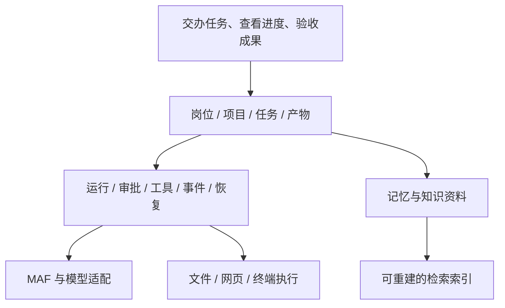

# 九个参考产品的深入比较与设计修正

更新：2026-10-14。研究范围为 OpenClaw、Codex、Pi、Paperclip、NextCoWork、Marvis、WorkBuddy、WeKnora，以及用户追加的 DeepSeek Harness。根据研究修订产品与技术文档；本轮只改文档，P0 保留未完成状态。

## 本轮比前一轮多回答了什么

前一轮主要回答技术方向是否可行，产品比较偏功能概览，不足以决定长期岗位如何协作、用户如何接管以及故障后怎样继续。本轮进一步追踪七个开源仓库的固定提交，并阅读腾讯两款产品的官方使用文档；重点记录实际调用链、状态与数据对象，而不只列功能名称。

证据分四层：**源码确认、官方声明、设计推论、尚未验证**。本轮没有安装或运行这些上游产品；没有把测试文件存在视为测试通过，也没有做速度、成本或答案质量排名。商业价值仍是待验证假设。

## 它们各自解决什么问题

下表是基于分项研究的定位归纳，具体事实与固定源码链接在每份研究内。

| 产品 | 主要参考层 | 最值得借鉴 | 关键边界 | 详细研究 |
| --- | --- | --- | --- | --- |
| OpenClaw | 长期助手、Gateway 与多渠道运行 | 输入接纳、会话写入归属、共享资源与独立 agent 状态 | 工作目录和技能可见性不等于执行隔离 | [OpenClaw](products/openclaw.md) |
| Codex | 交互式执行内核与客户端协议 | thread/turn/item、明确审批、工具事件、父子运行关系 | 会话可恢复不自动保证外部动作安全重放；公开 core 不等于整个桌面生态 | [Codex](products/codex.md) |
| Pi | 可嵌入的精简 harness | 模型/工具接口、可扩展循环、会话树；独立 Durable SDK 的重放策略 | CLI 与实验性 Durable SDK 是不同层；默认子 Agent 依靠扩展示例 | [Pi](products/pi.md) |
| Paperclip | 持续工作的岗位与任务控制面 | 岗位责任、任务领取、执行归属、阻塞交接和显式审阅 | 组织调度不是模型循环；完成、治理审批与成果验收须区分 | [Paperclip](products/paperclip.md) |
| NextCoWork | 本地可接管的桌面工作台 | 会话与工具事件、文件变更、子任务回执合并、设备命令账本 | Electron IPC 不是浏览器协议；刷新窗口与重启主进程是不同恢复级别 | [NextCoWork](products/nextcowork.md) |
| Marvis | 普通用户的任务入口与本地资料处理 | 预设分工、步骤与结果位置、可理解的本地/云端边界 | 本轮只有官方描述，不能判断内部队列、幂等与崩溃恢复 | [Marvis](products/marvis.md) |
| WorkBuddy | 面向办公成果的角色、项目与协作体验 | 按需使用专家、项目共享、依赖就地连接、上下文和产物交接 | 个人桌面、CLI 和企业托管不能混算；共享项目不代表全部数据仅本地 | [WorkBuddy](products/workbuddy.md) |
| WeKnora | 文档到答案的知识生命周期 | 解析/索引阶段、引用回原文、重建/删除、记忆确认 | RAG、个人记忆与岗位经验是不同对象；模型配置不代表已联调 | [WeKnora](products/weknora.md) |
| DeepSeek Harness | 独立 Web 工作台、日志与插件组合 | HTTP/WS 通信、cursor 重连、写前 flush、未知工具结果、可继续子会话 | 开发者预览；Teams 默认关闭；外部 MCP memory 不等于内建记忆治理；历史恢复不等于安全续跑 | [DeepSeek Harness](products/deepseek-harness.md) |

## 对原设想的六项修正建议

### 1. 岗位负责业务，子 Agent 负责一次分工

Paperclip 的长期 agent 有责任、待办和持续执行关系；Codex、Pi、NextCoWork 的 child/session/run 重点是一次运行协作。两类对象应关联，而非合成一个 `Agent` 表后同时承担所有职责。[Paperclip 责任模型](products/paperclip.md)、[Codex 父子运行](products/codex.md)、[Pi 扩展](products/pi.md)

建议本项目表达为：岗位定义工作职责和可用资源；岗位成员保存身份及持续经验；任务指定一个责任人；一次任务可有多次运行；运行可临时委派多个子任务。同一岗位多人协作，通过明确任务和成果交接解决，不能默认所有成员共享全部历史、任意写同一目录。

这仍是设计建议，不要求首版先实现完整组织人事系统。可以先用“运营助手”“开发助手”“资料整理”等模板，需要重复使用时再保存专属岗位。

### 2. 首页先让人交办任务，配置在需要时出现

WorkBuddy 的任务、角色与协作组分离，Marvis 的预设分工降低了先配置 Agent 的负担。对 OPC 的启发是从“要完成什么”开始，不强迫用户先理解模型 API、MCP、岗位树和共享目录。[WorkBuddy 专家文档](https://www.workbuddy.cn/docs/workbuddy/From-Beginner-to-Expert-Guide/Function-Description/Expert-Center)、[Marvis Agent 体系](https://marvis.qq.com/docs/agent-system)

建议主要菜单保持“工作台、项目、团队、资料、设置”。普通用户可直接输入任务、按需选择项目；模型或连接器缺失时显示具体补齐动作；高级协议、资源覆盖来源和日志可以展开查看。视觉风格服务于可读性，不能用毛玻璃掩盖状态和失败原因。

### 3. 用产物和验收组织流程

任务转交需要当前成果、上下文摘要和下一步；知识问答需要可定位的引用；“工具执行完”或“模型停止说话”不能直接表示业务验收。[WorkBuddy 项目](https://www.workbuddy.cn/docs/workbuddy/From-Beginner-to-Expert-Guide/Function-Description/Project)、[WeKnora 引用路径](products/weknora.md)、[Paperclip 审阅对象](products/paperclip.md)

建议任务页固定回答：谁负责、现在在做什么、被什么阻塞、已产出什么、还差哪项验收。产物记录至少关联任务、生成运行、版本、文件位置和验收结果。邮件汇报读取这些状态生成摘要，避免再让模型凭对话猜测“是否完成”。

### 4. 把恢复拆成可分别验证的能力

| 恢复层级 | 验证的问题 | 上游提供的参考 |
| --- | --- | --- |
| 会话恢复 | 旧消息、模型与上下文能否重新加载 | Pi session、Codex rollout、OpenClaw transcript |
| 界面重连 | 刷新或断线后能否看到最新状态及待答交互 | NextCoWork 主进程交互 gate、Codex App Server、DeepSeek snapshot/cursor |
| 进程重启 | 未完成任务由谁重新接管，待审批如何继续 | Paperclip 执行归属、Pi Durable checkpoint |
| 副作用对账 | 写文件/发信/发布已发生但回执未记账时怎么办 | NextCoWork device command 的 unknown；Pi 的 safe replay 边界；DeepSeek TOOL_OUTCOME_UNKNOWN |

以上参考均需按各自适用路径理解，不能拼成“这几款已证明全场景恰好一次”。各产品细节见 [NextCoWork](products/nextcowork.md)、[Pi](products/pi.md)、[OpenClaw](products/openclaw.md)、[Codex](products/codex.md)。

本项目应让关键动作具备稳定操作 ID、参数摘要、授权范围、执行状态和可核对回执。结果不确定时保留未知状态，先查询和对账；确实无法确认的外部动作不能自动重做。这也是 P0 应优先验证的合同，而不是先增加更多岗位。

### 5. 记忆、知识和上下文分开管理

建议至少分清四类：正在运行所需的工作上下文；可追溯的会话经历；经过确认的事实/偏好/岗位经验；有原文和引用的知识资料。摘要可以压缩上下文，但不替代原始历史；RAG 命中来源也不自动成为长期事实。[Pi 会话与压缩](products/pi.md)、[Codex 记忆提炼](products/codex.md)、[WeKnora memory 与 KB](products/weknora.md)

本项目的冷热策略应解决“现在要读什么、旧经验如何查、失效内容如何退出”三个问题。岗位私有经验发布到共享区需带来源和适用范围；错误或过期内容可更正与停用。WeKnora 的推断条目确认机制、WorkBuddy 的可编辑记忆都值得参考，但无需因此要求用户手动确认每一段临时摘要。[WorkBuddy 记忆](https://www.workbuddy.cn/docs/workbuddy/From-Beginner-to-Expert-Guide/Function-Description/Memory)

### 6. 扩展兼容必须逐层说明

Skills 是指令与资源；MCP 是工具服务协议；插件还可能包括可执行代码、界面、连接器授权与平台能力。这些在 OpenClaw、Pi、Codex、NextCoWork 中有不同的打包与运行规则。[OpenClaw 扩展边界](products/openclaw.md)、[Pi Packages](products/pi.md)、[NextCoWork 插件](products/nextcowork.md)

建议“兼容 Codex 插件”分为能识别清单、能导入受支持技能、能连接支持的 MCP、能执行指定 hook/工具、能使用平台专有能力五个层次。界面显示实际支持与缺失项；不把成功解压包写成兼容成功。工具授权必须由执行层控制，岗位提示词和技能白名单不能代替它。

## DeepSeek Harness 的追加结论

它为独立浏览器工作台提供了更直接的实现参考：Web 不依赖 Electron，命令走 HTTP RPC，长流走复用 WebSocket；Desktop 另作壳。日志重连、审批运行期交互和进程级恢复是三件事。默认 Web 组合有关键边界 flush，但其他组合可能没有，不能脱离 profile 宣称统一恢复保证。

实验性 Teams 虽保存成员与任务 claim，却不自动解决旧执行者、claim 释放及业务续跑；MCP memory 配置则接入外部存储。因此它进一步支持我们把岗位责任、执行租约、记忆治理和副作用对账各自建模。详见 [总研究](products/deepseek-harness.md)、[Web 调用链](deepseek-web-runtime.md)、[运行恢复](deepseek-runtime-recovery.md)。

## 对技术路线的影响

保留用户确定的 **React + 独立 .NET 10 服务 + SQLite + MAF，核心优先 AOT，Electron 后加**。这些产品支持我们学习职责划分，但大部分使用其他语言和运行时，不能用来证明 MAF 与 Native AOT 已兼容。

建议继续保持三层：产品层管理岗位/项目/任务/产物；Harness 管理运行、事件、审批、工具与恢复；Worker 处理具体模型循环及不适合 AOT 的依赖。RAG 解析器和扩展执行也可以有独立运行边界。MAF 负责适合它的运行能力，不承担完整产品数据库与业务生命周期。

图中是建议的职责关系，不代表已经实现或已冻结接口。目录和 SQLite 的权威边界沿用用户确认：配置与知识以文件为权威，任务与对话可用 SQLite 主存；导出 Markdown 不再建立第二个可编辑主副本。

## 设计已如何吸收，后续怎样验证

本轮已经把上述判断落入 [04 协作](../04-agent-harness-and-projects.md)、[06 记忆](../06-memory-and-knowledge.md)、[11 通信](../11-frontend-runtime-protocol.md)和新增 [13 恢复](../13-restart-and-recovery.md)，并更新架构、存储、界面及验收矩阵。所有合同仍为设计目标，当前不继续代码实现。

后续重新启动实施时：

1. 先用一个业务样例审查产品流程：交办“用指定资料做一份带引用的竞品报告”，确认从输入、必要配置、分工、阻塞到产物验收的页面与对象都说得清楚。
2. 继续现有 P0 时，优先完成审批持久化与副作用未知状态的故障验证；没有通过前不增加完整岗位系统。[P0 当前记录](../validation/2026-10-14/p0/README.md)
3. 实际体验对比采用同样任务和样本，不以截图判断优劣。办公用资料到报告；研发用受限目录内小修改；经营用带授权范围的跟进草稿。分别记录人工介入次数、成果质量、可追溯性和失败恢复。

每份分产品文档末尾都列有尚未执行的复现思路。研究交付到这里，可以用于修订设计；它没有证明上游运行质量，也没有替代真实用户对产品价值的验证。

## 查证快照与文档使用

| 仓库 | 固定提交 |
| --- | --- |
| openclaw/openclaw | `da6adccf7dba01914083e8f2b55116c1d02b05c8` |
| openai/codex | `95273b84fbff40f9df7d71d50f1ca52c6489b25d` |
| earendil-works/pi | `7efebff189ddc4077b332e1552fff899ed387d28` |
| paperclipai/paperclip | `2c17d3ca52a7840f280f1dd87975a2ad77de3b35` |
| AIDotNet/NextCoWork | `b9f580a6c7dadf5ee37e8f1d7e7c09d10a07b917` |
| Tencent/WeKnora | `6c3730a6adfd9e77e3472c3f0e3d10fcd805bda6` |
| deepseek-ai/deepseek-harness | `d743267388641bc76f17c45ce8b4c231aed1d32c` |

Marvis 与 WorkBuddy 为 2026-10-14 读取的官方文档快照，网页可能继续更新。研究只借鉴机制；本轮未复制上游实现，未作许可证适用性结论。

本报告是深入研究的总入口；此前两份概览保留为初始记录，后续以本报告和分产品固定提交研究中的明确范围为准。
